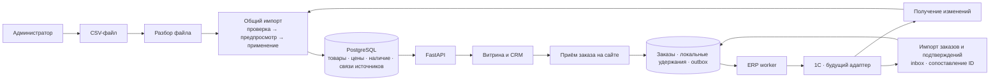

# Каталог из файла и будущий обмен с 1С

Статус: **архитектурное предложение, реализация отложена**. Основание — требования от 20.10.2026: сейчас предусмотреть загрузку номенклатуры из файла; в дальнейшем получать товары и остатки из 1С, а заказы — как с сайта, так и из 1С. Конфигурация 1С пока неизвестна. Этот документ не добавляет работающий импорт или подключение к учётной системе.

## Решение

Добавить в существующий FastAPI **модуль импорта каталога**. Первым источником станет файл, следующим — адаптер конкретной 1С. Оба преобразуют данные в один внутренний формат и используют одинаковые проверки и применение изменений. Витрина продолжает читать PostgreSQL через свой API.

Заказы обоих источников хранятся в едином реестре CRM. У каждого сохраняются происхождение, внутренний ID сайта и, когда он существует, ссылка документа 1С. Обмен обновляет тот же заказ, не создавая копию при обратном получении.

После подключения 1С она становится владельцем учётной номенклатуры, цен, свободных остатков и учётного исполнения заказов. Категории, фотографии, тексты витрины, обращения, ответственные и заметки остаются на сайте. Это не два независимых склада.

Для первого этапа принимаются ограничения: один каталог, одна организация, один склад, один тип цены, RUB, поштучное количество. Это допущения проекта; несколько складов и дробные единицы потребуют уточнения правил, а не простого сложения остатков.

Это целевая схема. Файловый импорт и ERP worker ещё предстоит реализовать; существующий процесс уведомлений Telegram работает отдельно.

## Границы владения данными

| Данные | Пока используется файл | После подключения 1С |
| --- | --- | --- |
| Стабильная ссылка, артикул, бренд, учётное имя, единица | Файловый источник | 1С |
| Цена выбранного типа и свободный остаток выбранного склада | Файл, только если эти поля предоставлены | 1С |
| Категория, фото, описание и заголовок для витрины | CRM | CRM; импорт их не перезаписывает |
| Обращение, ответственный, заметки и связь с заказом | CRM | CRM |
| Исходный состав и цены заявки с сайта | Неизменяемый снимок сайта | Снимок сайта сохраняется; ответ 1С хранится отдельно |
| Документ заказа, резерв, отмена, выдача | Файловый импорт таких фактов не создаёт | 1С; действия из CRM требуют подтверждения 1С |

Для учётных полей действует один активный источник. После переключения на 1С обычная загрузка файла не может перезаписать её цены или остатки. Переключение источника — отдельная административная операция со сверкой связей и аудитом.

## Модуль загрузки из файла

### Пользовательский сценарий

В CRM предусмотреть раздел администратора «Каталог → Импорт». Менеджеру права загрузки не нужны.

1. Администратор скачивает шаблон, выбирает файловый источник, загружает файл. Если есть цены/остатки, указывает момент их фактической актуальности; склад и тип цены берутся из настроенного источника.
2. Сервер проверяет весь файл и сохраняет подготовленный пакет. Показывает новые товары, изменения, пропуски неизменённых полей и ошибки с номерами строк. До применения витрина не меняется.
3. Администратор проверяет результат и нажимает «Применить». Пакет с ошибками применить нельзя.
4. Сервер одной транзакцией обновляет учётные поля и сопоставления. Отчёт показывает результат, время, автора и число изменений. Ручные категории, тексты, изображения и локальные удержания заказов сохраняются.

Начальный формат — **CSV, UTF-8 с допустимым BOM, разделитель `;`**, первая строка — заголовки. Это формат для экспорта из табличного редактора; поддержка XLSX не входит в первый вариант. Предлагаемый предел — 5 MiB и 10 000 строк. Их можно изменить при реализации после оценки реального каталога.

Пример: [catalog-import.csv](examples/catalog-import.csv). Все строки вымышленные. Файл иллюстрирует будущий контракт, сейчас загрузить его в приложение нельзя.

| Поле | Правило |
| --- | --- |
| `source_product_id` | Обязательно. Постоянный код товара внутри файлового источника, строка до 128 символов. Не номер строки, не имя файла и не временный UUID новой выгрузки |
| `sku` | Обязательная строка до 80 символов; ведущие нули сохраняются |
| `brand` | Обязательная строка до 80 символов |
| `name` | Обязательная строка до 240 символов, учётное наименование |
| `unit` | Для первого этапа только `шт`; количество целое |
| `price_rub` | Необязательно. Неотрицательное число рублей, до двух знаков после `.` или `,`, без разделителей тысяч и экспоненты; преобразуется в целые копейки без `float`, в пределах денежного диапазона API |
| `available_quantity` | Необязательно. Целое свободное количество от 0 до 2 147 483 647 для выбранного склада |
| `active` | Обязательно: `1` — активен, `0` — исключить из продажи, сохранив запись и связи |

Для добавления номенклатуры достаточно обязательных полей. Пустые цена и остаток **не означают ноль**: у существующей записи они не меняются; новая остаётся без подтверждённого предложения и недоступна для оформления. Известность цены и наличия хранится отдельно от их численного значения. Явный `0` в остатке означает отсутствие товара. Для публикации новой позиции дополнительно нужна видимая категория, назначенная в CRM.

При создании позиции одновременно создаётся `ProductPresentation` с пустым редакторским содержимым и заранее настроенной **скрытой категорией импорта «Неразобранное»**. Категория создаётся один раз, её ID хранится в настройках источника; перед применением проверяется, что она существует и скрыта. Это позволяет видеть новые позиции в действующем административном списке и назначать категории обычным редактором, сохраняя обязательную связь `ProductPresentation.category_id`. Существующим товарам категория не меняется. API и интерфейс должны различать неизвестные цену/наличие и явный ноль: отсутствие цены отображается как «Цена по запросу», не как бесплатный товар.

Файл обновляет только перечисленные позиции. Отсутствие товара в файле не удаляет и не деактивирует его. В первом варианте нет режима «заменить каталог целиком». Для снятия с продажи нужна явная строка `active=0`. Артикул и бренд помогают найти кандидатов на сопоставление, но не являются ключом автоматического объединения.

Ошибками всего пакета считаются: повтор `source_product_id`, пропущенные обязательные или неизвестные столбцы, неверная кодировка, лишние ячейки, некорректные числа, превышение лимитов, NUL и неподдерживаемая единица. При ошибке не записывается часть товаров. Если администратор поменял постоянный код, предпросмотр покажет новый товар: переименование кода требует отдельного сопоставления, иначе появится дубль.

### Применение и повторные запросы

Состояния пакета: `validating → ready | invalid`, затем `ready → applying → applied | failed`. Подготовленные строки и ошибки хранятся в БД; исходный файл после разбора можно удалить. Для применения достаточно нормализованных строк. Хеш исходного файла нужен для проверки неизменности попытки, а не для вечного запрета повторной загрузки тех же данных.

Загрузка и применение имеют независимые ключи идемпотентности. Повтор применения уже применённого пакета возвращает его отчёт. Проверяются права admin, Origin/CSRF, принадлежность пакета источнику и версия источника, на которой построен предпросмотр. Если другой импорт уже изменил источник, старый пакет получает конфликт и требует нового предпросмотра.

Публикация пакета, изменение ссылок и его итогового состояния выполняются атомарно. По одному источнику применяется один пакет; строки товаров блокируются в стабильном порядке. При ошибке транзакция откатывается. После падения процесса результат определяется по сохранённому состоянию пакета. Автоматического отката успешного импорта нет: он мог уже повлиять на новые заказы; исправления проходят новым пакетом с аудитом.

Повторная загрузка не делает старые остатки свежими: учитывается указанное время наблюдения источника, а не время загрузки или изменения названия товара. Более старые цены/остатки не заменяют новые. Предлагаемые административные операции, **ещё не существующие API**: создать пакет `POST /api/admin/catalog/imports`, получить предпросмотр `GET /api/admin/catalog/imports/{id}`, применить `POST /api/admin/catalog/imports/{id}/apply`.

### Внутренняя структура

Достаточно модуля внутри текущего backend и задач в PostgreSQL. Общая шина, плагинная система и отдельный сервис импорта не нужны.

| Часть | Назначение |
| --- | --- |
| Разбор CSV | Декодировать файл и получить нормализованные строки; не писать напрямую в `Product` |
| Проверка и предпросмотр | Проверить типы, постоянные коды, владельца полей, версии и вычислить изменения |
| Применение каталога | Единая транзакционная логика записи для файла и будущей 1С |
| Адаптер 1С | Преобразовать конкретные метаданные и события 1С в тот же внутренний формат |
| Импорт заказов | Отдельный сценарий сопоставления и обновления `Order`; не использовать сценарий создания веб-заказа |

Минимальные добавления к данным: `CatalogSource` с типом `file/1c`, областью и версией; `ProductSourceRef` со связью `(source_id, external_product_id) → Product.id`; `CatalogImport` и его подготовленные строки/ошибки. Ссылка источника уникальна, один товар не получает два разных кода одного источника без отдельного правила. Для 1С внешний ключ включает характеристику, если она участвует в учёте. Цены и наличие имеют свои отметки происхождения, известности, времени и версии. При одном складе и типе цены не нужен универсальный конструктор складского учёта.

## Переход от файла к 1С без потери карточек

Внутренний `Product.id` остаётся прежним. Файловый код живёт в пространстве своего источника, GUID 1С — в пространстве базы 1С. Это разные ссылки на один товар, а не повод заменить внутренний ID. Для характеристик/вариантов 1С идентичность должна включать вариант: две характеристики одной номенклатуры не сливаются.

Перед переключением загрузить данные 1С в предпросмотр, подготовить таблицу соответствий «код файла → ссылка номенклатуры/характеристики 1С», показать совпадения и конфликты. Администратор подтверждает неоднозначные соответствия. Автоматически сливать по названию или одному артикулу нельзя. После проверки добавить ссылки 1С существующим товарам и переключить владельца учётных полей.

Категории, фото, тексты, ссылки корзин и история заказов сохраняют внутренние ID. Несопоставленные позиции остаются видны администратору и исключаются из новых ERP-заказов. Подключение 1С не экспортирует автоматически все исторические заказы: объём первоначальной миграции согласуется отдельно.

В текущей модели есть единственный `Product.external_id`. При реализации его потребуется мигрировать в явные ссылки источников; нельзя записать туда файловый код и позднее предположить, что это GUID 1С. Существующие ссылки и заказы нужно сохранить миграцией.

## Работа с товарами на сайте

Покупатель ищет товар по артикулу, бренду и названию, открывает карточку, выбирает количество и добавляет в корзину. Цена и доступность читаются из локальной проекции; у предложения известны источник и момент актуальности. Нулевой остаток не обязан скрывать карточку, но исключает подтверждение покупки; посетитель может оставить обращение менеджеру.

При оформлении API повторно проверяет публичную видимость, состав, цену и доступность. Изменение цены не принимается молча: покупатель либо менеджер согласует новый состав/цену. Исторические цены заказов не меняются вслед за каталогом.

Файловый импорт сам по себе не подтверждает наличие на складе и не включает оформление без 1С. До реализации авторитетного подтверждения сохраняется действующее ограничение API: корзина и обращения доступны, создание реального заказа требует подключённого адаптера. Если потребуется продавать до подключения 1С, отдельным решением станет ручное подтверждение локальных заявок; это не скрытая функция загрузчика файла.

После подключения адаптера свежая локальная проекция позволяет надёжно принять **заявку на заказ**, даже если 1С временно не отвечает. Успех означает «заявка сохранена, ожидает подтверждения», а не гарантию резерва. При слишком старых ценах/остатках оформление блокируется, просмотр и обращения остаются доступны. Предлагаемый начальный ориентир: обновление раз в минуту, блокировка оформления после пяти минут без успешного обновления цен/наличия. Порог согласуется с реальным обменом; сейчас в коде используется один день, это ещё потребуется изменить.

## Заказы с сайта и из 1С

### Заказ с сайта

1. Одна транзакция сохраняет заказ `new`, исходный снимок товаров/цен, локальные удержания, ключ попытки и `order_export` в outbox. В снимок для экспорта входят постоянные ссылки товаров/характеристик 1С, а не только внутренние ID сайта.
2. ERP worker отправляет постоянный `site_id + Order.id` и ключ операции. Получатель в 1С атомарно проверяет повтор, актуальную цену и свободный остаток, создаёт документ и резерв штатной логикой конфигурации, сохраняет результат операции.
3. Только подтверждённый документ и резерв дают `confirmed`. Нехватка, новая цена или неверные реквизиты оставляют понятную причину для менеджера. Техническая доставка и бизнес-решение отображаются отдельно; неуспех не теряет заявку и не подтверждает её автоматически.
4. Последующий импорт документа из 1С находит тот же `Order` по постоянной ссылке сайта либо уже сохранённой ссылке 1С. Происхождение остаётся `site`.

Текущая конверсия обращения в заказ использует тот же сценарий: `converted` означает создание заказа в CRM, а подтверждение 1С приходит позже. При ошибке экспорта связанный заказ остаётся доступен менеджеру.

### Заказ, созданный в 1С

1. В согласованный обмен включаются заказы выбранной организации/склада и разрешённого типа. Граница начальной загрузки — активные заказы и согласованная дата; не вся история базы по умолчанию.
2. Импорт ищет запись по `(base_id, document_type, document_id)`, затем создаёт либо обновляет её. Для отражения заказа сайта сначала проверяется его `site_id + Order.id`. Если ссылки указывают на разные записи, возникает конфликт для разбора, автоматического слияния нет.
3. Новый входящий заказ имеет `origin=1c`. Он не создаёт `order_export` и не вычитает дополнительный локальный резерв: резерв уже принадлежит 1С. Отображается как «Создан в 1С / синхронизирован».
4. Импорт не вызывает `build_order()`: в учётном документе допустимы скрытые на витрине товары, индивидуальные цены и другой набор контактов. Неизвестная позиция сохраняется в снимке заказа с отметкой о несопоставленной ссылке, не публикуется автоматически как новый товар.
5. Если менеджер оформил заказ в 1С после обращения на сайте, он привязывает уже импортированный заказ к обращению, вместо повторного создания. Нужны проверка ответственного, версии, уникальности связи и аудит; сейчас такого действия ещё нет.

Для обоих источников действуют уникальные внешние ссылки и неизменяемое происхождение. Номер, телефон или email не являются ключом объединения. Входящие данные применяются только по более новой версии источника; дубликат безопасно подтверждается без повторного действия.

### Кто управляет статусами

`origin` отвечает на вопрос «где создали заказ», бизнес-статус — «что с ним происходит», состояние обмена — «доставлены ли изменения». Эти признаки независимы. Существующее `exported` не подходит как единственная подпись для входящего заказа: интерфейс должен учитывать направление обмена.

На первом этапе импорта заказы 1С отображаются для чтения; менеджер работает с обращениями и связывает их с заказами. После принятия заказа 1С учётные переходы, в том числе отмена и завершение выдачи, поступают из 1С. Чтобы запускать их через сайт, нужен следующий этап: CRM сохраняет команду в outbox, показывает ожидание и меняет подтверждённый статус только после результата 1С. Одновременное независимое редактирование статуса в двух базах исключается.

Это уточняет нынешнее поведение: сейчас CRM умеет локально менять `ready/completed` после экспорта, не отправляя команду в 1С. Перед реальным двусторонним обменом эти действия надо перевести на согласованный командный контракт. Безопасная отмена ещё не отправленного заказа остаётся локальной; при неизвестном результате отправки резерв не освобождается.

Исходная заявка и её цены сохраняются. Более поздние изменения документа 1С записываются как новая учётная версия с историей, не подменяют незаметно то, что согласовал покупатель. Возвраты, частичные отгрузки и сложные обратные переходы требуют отдельного сценария; несопоставимый статус становится задачей сверки, а не угадывается по названию.

## Остатки и резервирование

Контракт наличия должен определять **свободное к продаже количество после всех резервов 1С** по выбранному складу. Физический остаток, ожидаемый приход и свободный остаток — разные величины. В MVP не суммируются склады, между которыми нельзя немедленно выполнить заказ.

Для ожидающего веб-заказа хранится отдельное локальное удержание по заказу и товару. Текущее суммарное `Product.reserved` можно оставить производной величиной, но его одного недостаточно для передачи резерва.

`Доступно на сайте = max(0, свободно по принятой версии 1С − локальные удержания, ещё не учтённые этой версией).`

Пример: 1С сообщила 10 штук, сайт принял 2 — показывает 8. Когда 1С зарезервировала эти 2, новый свободный остаток равен 8. В одной локальной транзакции принимается соответствующая версия остатка и снимается именно это локальное удержание: на сайте остаётся 8, а не 6 и не 10.

Нужно подтверждение, какая версия остатков уже учитывает конкретный резерв. Это может быть согласованный монотонный номер изменения в адаптере либо согласованный снимок остатков и включённых резервов. Наличие такой гарантии у конкретной 1С пока не установлено. Простого успешного HTTP-ответа недостаточно.

Если связь версий обеспечить нельзя, автоматическое снятие локального удержания откладывается до достоверной сверки; витрина может временно занижать наличие. Окончательный резерв всё равно проверяет 1С в своей транзакции. Локальные блокировки сайта не защищают от параллельного заказа непосредственно в 1С.

Импорт файла никогда не обнуляет `reserved`. Время и версия отдельно фиксируются для номенклатуры, цены и наличия; переименование товара не обновляет свежесть склада. Полный снимок 1С сначала подготавливается, затем активируется согласованно. Отсутствие товара в неполной странице обмена не является удалением.

## Надёжность обмена и выбор протокола

Для текущего монолита достаточно отдельного ERP worker из того же backend-образа, PostgreSQL outbox исходящих команд и inbox входящих событий. Telegram worker продолжает обслуживать свои события. Сеть не вызывается внутри длительной транзакции PostgreSQL.

Получение изменений — пакетами с устойчивым курсором/версией, а не фильтром «дата документа позже последней». Обновление локальных сущностей, запись входящего события и продвижение курсора — одна транзакция; подтверждение источнику отправляется после её фиксации. Уникальность события задаётся источником и постоянным ID события, устаревшая версия не затирает новую.

Доставка допускает повторы. Временные ошибки повторяются с задержкой; неверные реквизиты/цены/наличие требуют исправления. Если при отправке потерялся ответ, worker выясняет результат по постоянной ссылке заказа/операции. Неизвестный исход не означает, что документ не создан. После перезапуска используются те же идентификаторы; истечение аренды задачи не даёт права создать второй документ. Для вернувшегося старого worker проверяется принадлежность актуальной попытке.

| Вариант 1С | Оценка для проекта |
| --- | --- |
| Собственный HTTP-сервис | Предпочтителен для точного контракта «найти/создать заказ + проверить цену + резерв + идемпотентность». Требует разработки в конкретной 1С; это проектируемые методы, а не готовые штатные endpoint. [Возможности платформы](https://v8.1c.ru/platforma/http-servisy/) |
| Штатный обмен с сайтом / CommerceML | В первую очередь проверить после определения конфигурации: он уже предусматривает каталог, цены, остатки и обмен заказами. Реальные направления импорта новых заказов, идентичность, задержки и подтверждения резерва надо проверить в установленном решении. Протокол инициируется со стороны 1С. [Описание протокола](https://v8.1c.ru/tekhnologii/obmen-dannymi-i-integratsiya/standarty-i-formaty/protokol-obmena-s-saytom/) |
| Стандартный REST/OData | Умеет читать и изменять данные, создавать и проводить документы. Это не гарантирует единую безопасно повторяемую бизнес-операцию заказа и резерва; бизнес-логику конкретной конфигурации всё равно нужно проверить. [Описание REST](https://v8.1c.ru/platforma/rest-interfeys/) |

Регистрацию изменений можно построить на механизме планов обмена 1С, если он применим к выбранной конфигурации; это не готовый endpoint. [Официальное описание регистрации изменений](https://v8.1c.ru/platforma/sluzhba-registratsii-izmeneniy/). Транспорт и направление сетевого соединения выбираются после выяснения размещения базы; для закрытой 1С возможен инициируемый ею обмен через защищённый endpoint сайта.

Браузер не получает адрес и секреты 1С. Технический доступ обмена отделён от сессий сотрудников, ограничен областью данных, использует TLS и отдельные серверные секреты. Контакты и внешние снимки заказов доступны только уполномоченным сотрудникам. Заказ из 1С не связывается с публичным посетителем по совпадению телефона; клиентского личного кабинета сейчас нет. Контакты и полные тела документов не копируются в технические логи.

Сверка должна видеть отставание цен/остатков/заказов, неподтверждённые удержания, потерянные ссылки, неизвестный результат команд и очередь ошибок. Ручной повтор использует исходную операцию; для исправленной бизнес-команды создаётся новая версия с новым ключом, сохраняя ID самого заказа.

## Что уже есть и что предстоит

| Основа в проекте | Что добавить при реализации |
| --- | --- |
| `Product` и отдельный `ProductPresentation` | Файловый импорт, ссылки источников, известность и версии предложений; скрытая категория для новых позиций; сохранить редакторские данные |
| `Order`, квитанция и ключ попытки | Происхождение, уникальная ссылка 1С, версия учётного снимка и импорт без повторного резерва |
| Транзакция заказа, `Product.reserved`, `order_export` | Удержания по заказам, подтверждение передачи резерва и внешние ссылки товаров в снимке |
| Outbox и состояние интеграции | Настоящий адаптер, ERP worker, inbox, устойчивые курсоры и сверка |
| Обращение → новый заказ | Привязка к существующему импортированному заказу с правами и аудитом |
| Закрытые API, CSRF, версии, аудит | Те же проверки для предпросмотра, применения и переключения источника |

Основные точки будущих изменений: `backend/app/catalog.py`, `orders.py`, `integration.py`, `feedback.py`, новые серверные модуль импорта и ERP worker; миграции Alembic; `src/data/http-api.js`, CRM каталога/заказов и состояния интерфейса; OpenAPI, конфигурация и Compose для ERP worker. Конкретные маршруты и код не добавляются до реализации.

## Последовательность реализации и приёмка

1. **Файловый каталог:** ссылки источника, CSV → проверка → предпросмотр → атомарное применение, отчёт, права и аудит. Проверить добавление/обновление, ведущие нули, пустые поля и явный ноль, повтор применения, ошибку одной строки и конкурирующие пакеты. Заказы/удержания и оформление витрины не должны повреждаться.
2. **Каталог 1С:** выбрать конфигурацию, область обмена и протокол; сопоставить существующие товары, импортировать цены/свободные остатки и версии, переключить владельца. Проверить сохранность фото/категорий/ID, запрет перезаписи старым файлом и запоздавшими событиями.
3. **Заказ сайта → 1С:** реализовать надёжный приём и резервирование, внешние ссылки в снимке, передачу удержания, поиск после потерянного ответа. Проверить одновременный заказ последних единиц на сайте и в 1С, повтор после рестарта и отсутствие двойного вычитания.
4. **Заказ 1С → CRM:** первоначальная область загрузки, входящие версии, отсутствие обратного экспорта, привязка обращения к существующему заказу. Проверить импорт до получения ответа экспорта, повтор одной страницы, конфликт ссылок и неизвестный товар.
5. **Управление через сайт:** согласованные команды статусов/отмены с подтверждениями, права и история. Проверить недоступность 1С, неизвестный исход и конфликт с более новым состоянием документа.

Файловый модуль можно реализовать независимо от выбора 1С. Для её подключения останется выяснить конфигурацию/версию, размещение и доступность расширений, организацию/склад/цену, характеристики и единицы, тип заказа, правила резерва и отображения статусов, границу импорта заказов и гарантию версий наличия. До этого не фиксируются URL 1С, имена её объектов и правила проведения документов.
