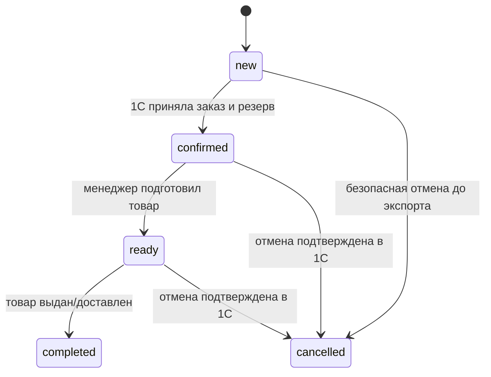

# LAVR: витрина автозапчастей и CRM, MVP

## Реализованная система и оставшийся обмен

В репозитории реализованы **тонкий frontend на Vue 3 + Vite, FastAPI и PostgreSQL**. Docker Compose запускает все три сервиса; Nginx направляет same-origin `/api` в backend. Alembic создаёт схему, bootstrap создаёт первого администратора и при явном `SEED_DEMO_CATALOG=true` загружает примеры каталога и контента на сервер. База и изображения находятся в постоянных volumes. Настоящий обмен с 1С пока не подключён: отдельный адаптер отключён, оформление возвращает `503 ERP_NOT_CONFIGURED`.

`npm run dev`/`build` используют HTTP API, `dev:demo`/`build:demo` — самостоятельное локальное демо; необязательный `VITE_DATA_MODE=api|demo` переопределяет выбор. Dev-прокси направляет `/api` на `API_PROXY_TARGET` (по умолчанию `http://127.0.0.1:8000`), эту переменную не получает браузер. Ошибка API сохраняет форму и предлагает повтор без автоматического demo fallback.

`src/main.js` выбирает `src/data/http-api.js` или `src/data/demo-api.js`; Vue-компоненты вызывают общий асинхронный интерфейс. В API-режиме главная, категории, товары и заказы читаются с сервера; поиск, фильтры, сортировка и пагинация выполняются API. HTTP-клиент проверяет ответы. Вход, текущая сессия и выход сотрудника подключены к `/api/manager/session`; роль `manager` открывает заказы, `admin` — также каталог и редактор контента. Создание категории, назначение категории существующему товару, настройки сайта, публикации и загрузка медиа используют закрытый HTTP API и CSRF; изменения существующих версионируемых записей передают `If-Match`. FastAPI проверяет доступ и версии, сохраняет изменения и аудит в PostgreSQL; изображения выдаются только после проверки публичной связи либо административной сессии.

В API-режиме frontend записывает в `localStorage` только черновик корзины `productId`/`quantity` (`lavr.cart.v1`). Технический UUID и SHA-256 отпечаток попытки оформления сохраняются в `sessionStorage` (`lavr.checkout-attempt.v1`) для повторного запроса с тем же ключом; тело заказа и контакты туда не записываются. Контакты формы, загруженные данные и сессия находятся в памяти страницы. Сервер должен оставаться источником цены, наличия, полномочий и итогового заказа; клиентский итог предварительный. Ошибка API сохраняет форму и корзину без ложного успеха. Дизайн лендинга сохранён, содержимое поступает через `getSite()`.

Только в явном демо каталог сохраняется в `localStorage` (`lavr.catalog.v1`), заказы с вымышленными контактами — в `sessionStorage` текущей вкладки (`lavr.orders.v1`). `src/catalog-admin.js` проверяет снимок, связи и уникальность; изменение применяется после успешной записи. Повреждённый каталог сохраняется без перезаписи, изменения и оформление блокируются до восстановления. Настройки сайта и публикации сохраняет `src/data/demo-content-api.js` в JSON под ключом `lavr.site.v1`; `src/data/demo-media.js` хранит загруженные Blob в IndexedDB `lavr-media-v1` и создаёт временные URL при чтении. Связи контента используют ID медиа, прежние данные сохраняются при ошибке записи; повреждённый JSON делает редактор доступным только для чтения. CRM демо открыта, `integrationStatus: not_connected` не означает отправку в 1С. Создание товара с демонстрационными ценой и остатком остаётся только здесь; `src/data/demo-site.js` задаёт исходные три примера публикаций.

Далее описаны серверная архитектура и контракт [api.openapi.yaml](api.openapi.yaml), который используют клиент и backend. Транзакционные резервы, идемпотентность и outbox проверяются на настоящем PostgreSQL с настроенным адаптером только в тестах. Worker и живой обмен остаются будущим этапом после выбора конфигурации 1С; создание учётной номенклатуры требует отдельного согласованного контракта. Оплата исключена из MVP; стоимость доставки менеджер уточняет отдельно.

## Адаптивное отображение

Один Vue frontend обслуживает телефон, планшет и компьютер в пользовательском и административном режимах. Размер экрана меняет сетку, меню и расположение элементов через CSS, сохраняя общий контракт API и серверные проверки прав. Категории и пункты меню не скрываются из-за устройства: компактное меню выводит те же данные с сервера. Дизайн лендинга сохраняется.

Минимальная проверяемая ширина — 320 px. До 1100 px используется раскрываемое меню, до 760 px — мобильная компоновка поиска, фильтров, корзины и форм. Для сенсорного ввода основные цели нажатия — от 44×44 px, поля — от 16 px. Таблицы заказов и номенклатуры имеют собственную горизонтальную прокрутку, доступную также с клавиатуры; диалоги ограничены высотой экрана, кнопка закрытия остаётся видна. Портретная и альбомная ориентации используют те же операции API; редактор сайта и медиабиблиотека адаптируются теми же CSS-правилами. Перед выпуском требуется проверка на физических iOS/Android, включая экранную клавиатуру.

## Тонкий клиент и два режима

Один frontend Vue 3 + Vite имеет два режима: **пользовательский** и **административный**. FastAPI — единая точка чтения и изменения данных. PostgreSQL хранит каталог-проекцию, категории, заказы, сотрудников, меню, тексты, публикации, связи изображений и outbox. Файлы изображений хранятся в постоянном серверном media volume; в БД находятся их идентификаторы, пути и метаданные. Сервер хранит данные независимо от браузера менеджера и обновления сборки frontend.

Vue отвечает за отображение, форму, навигацию, предпросмотр и временное состояние. До оформления корзина — черновик `productId`/`quantity`; показанный на фронте денежный итог предварительный. Сервер повторно проверяет цену, наличие, полномочия и данные заказа. Каталог, заказы, настройки сайта, роль сотрудника и контакты рабочей системы не сохраняются как авторитетные данные в `localStorage`/`sessionStorage`. Поиск, фильтры, сортировка и пагинация выполняются API. Отсутствие ответа сервера не переключает рабочее приложение на исходный демокаталог и не создаёт локальный «успешный» заказ.

| Режим | Экраны и действия | Серверная граница |
| --- | --- | --- |
| Пользовательский | Главная, опубликованные акции/объявления, категории, поиск по артикулу, карточка товара, корзина, оформление без оплаты | Публичные чтения и `POST /api/orders`; без входа, списка клиентов и доступа к черновикам |
| Административный | Вход сотрудника; заказы; категории и оформление товаров; меню, тексты/баннер главной, акции/объявления, медиабиблиотека; состояние интеграции | Закрытые API; действующая серверная сессия, роль, CSRF для изменений и проверка версии записи |

Внутри административного режима роли разделяют обязанности: `manager` читает и обрабатывает заказы; `admin` дополнительно управляет каталогом витрины, контентом, изображениями и обменом. При запуске одним разработчиком достаточно учётной записи `admin`; отдельные менеджеры создаются по необходимости. Скрытие меню или frontend route guard помогает навигации, но каждый закрытый API самостоятельно проверяет доступ. Прямой запрос покупателя к административному endpoint получает `401`, запрос сотрудника с недостаточной ролью — `403`.

Целевые маршруты SPA: `/`, `/catalog`, `/cart`; закрытая зона `/admin/login`, `/admin/orders`, `/admin/catalog`, `/admin/site`, `/admin/publications`, `/admin/media`. Vue Router ещё не подключён: в обоих источниках используются текущие hash-маршруты `#catalog`, `#cart`, `#crm`, `#crm-catalog`, `#crm-content`, вход показан внутри CRM. На `#crm-content` роль `admin` открывает вкладки «Главная и меню», «Публикации», «Изображения». Дизайн лендинга и готовые шаблоны карточек сохраняются: редактор меняет содержимое и порядок в существующих шаблонах, все подписи остаются обычным текстом.

Поток изменения: административная форма → защищённый FastAPI → PostgreSQL/хранилище файлов → публичный API → пользовательская витрина. Успех показывается только после подтверждения сервера. Клиент передаёт `If-Match`; устаревшее изменение получает `412`, сохранённая другим сотрудником версия не перезаписывается. Публикации с состоянием `draft`/`archived` или вне интервала действия исключаются сервером из публичного ответа; скрытые категории и товары также недоступны для заказа.

## Состав рабочей системы

Пользователь выбрал **Python / FastAPI + Vue**: разработчик один, основной опыт — Python. Рабочая система проектируется как модульный монолит на FastAPI и PostgreSQL. Один backend содержит каталог, заказы, доступ менеджеров и адаптер 1С; обработчик обмена запускается отдельным Python-процессом из той же кодовой базы. PostgreSQL хранит очередь outbox, поэтому отдельный брокер для MVP не требуется.

| Слой | Стек и назначение |
| --- | --- |
| Frontend рабочей CRM | Vue 3 + Vite, Vue Router; закрытые страницы заказов, каталога и контента сайта. Обычного `fetch` достаточно для API; роль и права получаются с сервера |
| Публичная витрина | Vue 3 + Vite для MVP — выбор подтверждён пользователем. SEO отложено; необходимость Nuxt оценить после MVP при появлении требований к органическому поиску |
| Backend | FastAPI, Pydantic для входных/выходных схем, бизнес-модули через `APIRouter` |
| Данные | PostgreSQL, SQLAlchemy 2 для транзакций/моделей, Alembic для миграций |
| Обмен с 1С | Отдельный Python worker и адаптер, HTTPX для HTTP-обмена; очередь/повторные попытки в PostgreSQL outbox |
| Проверки рабочей версии | pytest для домена/API, Playwright для пути покупателя и менеджера |
| Запуск | Docker Compose: frontend, API, worker, PostgreSQL, постоянный media volume; одна кодовая база backend для API и worker |

Это целевой стек рабочей версии. Vue SFC, Vite и HTTP-клиент уже реализованы; FastAPI, база данных и обмен с 1С — следующий этап. Для синхронизации не используются `FastAPI BackgroundTasks`: задачи обмена должны переживать перезапуск API и фиксируются транзакционно в outbox. Один `Session`/`AsyncSession` SQLAlchemy создаётся на запрос или задачу, не разделяется между параллельными задачами. При выборе синхронной сессии обработчики работают в синхронных функциях; блокирующий доступ к БД не помещается в `async def`.

Границы модулей FastAPI: `catalog`, `orders`, `customers`, `auth`, `site`, `media`, `integration`. Схемы Pydantic отделены от моделей SQLAlchemy и ответа 1С; менеджерские ответы с контактами не используются в публичном API. Запросы сессии/ролей проверяются через зависимости FastAPI, а доменная логика и адаптер работают независимо от HTTP-слоя. Официальные руководства: [модульная структура FastAPI](https://fastapi.tiangolo.com/tutorial/bigger-applications/), [Vue 3](https://vuejs.org/guide/introduction.html), [SQLAlchemy asyncio](https://docs.sqlalchemy.org/en/20/orm/extensions/asyncio.html), [Alembic](https://alembic.sqlalchemy.org/en/latest/).

Редактируемая Mermaid-схема, ответственность компонентов и основные потоки: [system-diagram.md](system-diagram.md). Vue, FastAPI, PostgreSQL и media volume реализованы; схема также показывает будущий worker и подключение 1С.

Браузер обращается только к своему API. Адрес, пароль, токены и технические реквизиты 1С доступны только backend/worker; публикация 1С не открывается покупателям. Витрина читает локальную проекцию каталога и не зависит от времени ответа 1С на каждый поиск.

| Модуль | Ответственность |
| --- | --- |
| Каталог | Поиск прежде всего по артикулу, а также по наименованию и бренду; категории витрины и назначения из CRM; проекция номенклатуры, цен и наличия из 1С |
| Заказы | Проверка заявки, резерв проекции, неизменяемые цены, статусы, идемпотентность |
| Доступ | Сессии сотрудников, роли `manager`/`admin`, аудит изменений |
| Сайт | Меню, тексты и баннер главной, акции/анонсы/горячие предложения; публикация и сроки видимости |
| Медиа | Проверенная загрузка, метаданные и связи файлов; закрытый предпросмотр и выдача опубликованных изображений |
| Интеграция | Импорт, экспорт заказов, повторная доставка, сверка неопределённых результатов, состояние обмена |

## Модель данных и владельцы

| Сущность | Минимальные поля и ограничения |
| --- | --- |
| `Category` | `id`, `name`, `position`, `isVisible`, `showInMenu`, `version`; необязательное сопоставление с внешней группой 1С; названия уникальны без учёта регистра и лишних пробелов |
| `Product` | `id`, `externalId`, `sku`, `brand`, `name`, `category` — ссылка на одну `Category.id`, `priceKopecks`, `stock`, `isActive` проекции 1С, `image`, `deliveryDays`; уникальный `(source, externalId)` |
| `ProductPresentation` | `productId`, категория витрины, необязательные `websiteTitle`/`websiteDescription`, `imageIds`, `version`; импорт 1С не перезаписывает редакторские поля |
| `SiteConfiguration` | Одна запись: `hero` с заголовком/описанием/изображением и кнопкой, `settings` с реквизитами/заголовками блоков, `menu`, `version`; ссылки только на разрешённые внутренние маршруты/объекты |
| `Publication` | `id`, тип `offer`/`announcement`/`hot`, заголовок, описание, изображения, кнопка и внутренняя цель, порядок, `draft`/`published`/`archived`, необязательные даты действия, `version` |
| `MediaAsset` | `id`, серверный путь, MIME, размер, ширина/высота, alt, время создания; файл отдельно от PostgreSQL, ссылки только на успешно сохранённый файл |
| `CartItem` | `productId`, `quantity`; корзина не является источником цен или резервом |
| `Order` | `id`, уникальный `number`, `createdAt`, контакты, способ получения, `totalKopecks`, бизнес-статус, состояние обмена, версия для конкурентных изменений, `externalDocumentId` после ответа 1С |
| `OrderItem` | `productId`, внутренняя ссылка 1С, снимки `sku`/`brand`/`name`, `quantity`, `unitPriceKopecks`; после создания заказа не изменяются |
| `Idempotency` | HTTP-метод + фактический путь с `orderId` + сотрудник для административных команд, ключ, хеш нормализованного запроса, исходный безопасный ответ; уникальность внутри этой области |
| `OutboxEvent` | `eventId`, `orderId`, вид события, снимок payload, попытки, время следующей попытки, lease, результат; уникальный `eventId` |
| `SyncState` | Курсор импорта, версии внешних данных, даты успешного обмена, очередь ошибок |
| `AuditEntry` | Сотрудник, время, тип/ID объекта, действие и версия; изменения статуса заказа/категории/контента; контакты и секреты не копируются в лог |

1С — источник номенклатуры, артикулов, цен выбранного типа и доступных остатков выбранного склада. Внутренний `id` сайта стабилен, `externalId` — непрозрачная неизменная ссылка 1С; артикул или наименование не заменяют ссылку и не используются для дедупликации. Артикул — основной ориентир покупателя при поиске; у разных брендов он может совпадать. Удалённый/помеченный на удаление товар получает `isActive: false`, скрывается из продаж, но сохраняет связи с заказами. Одна проверка публичной видимости используется для каталога, карточки, меню/публикации, оформления и выдачи медиа: товар активен в проекции **и** его категория видима. Остаток ноль запрещает добавление/оформление, но сам по себе не скрывает карточку.

Категории витрины — сущности магазина, которыми управляет CRM; их набор не ограничен шестью исходными демокатегориями. Товару назначается одна категория. Адаптер может сопоставлять категории группам 1С по согласованным правилам; импорт не должен без такого правила стирать категории или ручные назначения витрины. Изображения и срок поставки могут быть дополнениями витрины, если их нет в 1С.

Назначение хранится один раз в `ProductPresentation.categoryId`; поле `Product.category` в HTTP-ответе — его проекция для совместимости с UI. Импорт учётных полей 1С не создаёт вторую независимую категорию товара и не перезаписывает ручное назначение. `Product.image`, `images`, `websiteTitle` и `websiteDescription` также формируются сервером из редакторских данных с проверкой публичной видимости.

Создание категории и назначение категории существующей номенклатуре уже подключены к закрытому HTTP API; серверная проверка прав, аудит и хранение ещё требуют реализации. Переименование категории сохраняет её ID и связи. Скрытие категории исключает её и назначенные ей товары из публичного каталога и оформления; возврат видимости сохраняет связи. Создание новой учётной номенклатуры из CRM требует серверного адаптера и отдельного согласованного контракта записи в конкретную конфигурацию 1С. До согласования конфигурации, обязательных реквизитов и результата записи форма доступна только в локальном демо; её цена и остаток не обновляют 1С.

## Контент и изображения сайта

Администратор редактирует существующие шаблоны: меню/баннер/заголовки блоков — через `SiteConfiguration`, объявления/акции — через `Publication`, описание и фотографии товаров — через `ProductPresentation`. Показ категорий в каталожном меню определяется `showInMenu` и `position`; отдельный список `menu` задаёт дополнительные пункты навигации со ссылками на каталог, категорию, товар или существующий блок. Добавление пункта меню не создаёт новую страницу. Цена, остаток и артикул остаются данными 1С; публикация рекламной акции не изменяет цену заказа.

Реализованный `ContentManager.vue` объединяет три вкладки. «Главная и меню» редактирует первый экран, контакты, заголовки разделов и до 12 пунктов меню с внутренней целью, порядком и видимостью. «Публикации» управляет типами `offer`/`announcement`/`hot`, текстом, кнопкой, внутренней целью, порядком, статусом, датами и до восьми ID изображений. «Изображения» загружает поля `file` и `alt` через multipart и показывает библиотеку с пагинацией; `MediaSelector.vue` сохраняет выбранные ID при смене страницы, `ContentTarget.vue` задаёт внутренние ссылки. Ошибки сохраняют форму; конфликт `412` отключает повторное сохранение до загрузки актуальной версии. Уход с несохранёнными изменениями запрашивает подтверждение. Настройки и публикации хранят ID медиа, а предпросмотр получает пути из источника данных. Серверные права, хранение и выдача файлов в HTTP-режиме требуют реализации backend.

Форма новой публикации начинает со статуса `draft`; после перевода в `published` запись становится видимой в период действия. Необязательные `startsAt`/`endsAt` передаются как ISO 8601 с часовым поясом, `endsAt` должен быть позже `startsAt`; сервер показывает запись при `startsAt <= now < endsAt`, учитывая отсутствующие границы. Форма отображает даты по часовому поясу устройства и переводит изменённые значения в UTC; неизменённые даты сохраняют исходную точность. Архивирование снимает запись с витрины. Предпросмотр черновика доступен только административной сессии.

Административная загрузка принимает JPG/PNG/WebP до **5 MiB (5 242 880 байт)** и размером до **4096 × 4096**. Сервер проверяет фактический формат декодированием, выдаёт собственное UUID-имя и не доверяет имени файла или заявленному Content-Type. Alt — до 240 символов, пустой допустим для декоративного изображения. Проверенный файл сохраняется на постоянный media volume вне `dist/`, исходников и временного слоя контейнера, затем создаётся запись `MediaAsset`; ошибка загрузки не меняет старые ссылки. Замена создаёт новый URL и меняет связь только после успешного сохранения. Неиспользуемые файлы удаляются отдельно после проверки ссылок; при ошибке БД уже записанный файл может стать сиротой для последующей очистки, а прежнее изображение остаётся рабочим.

`GET /api/admin/media/{mediaId}/file` выдаёт закрытый предпросмотр. `GET /api/media/{mediaId}` выдаёт файл только при наличии актуальной публичной ссылки из видимого товара, опубликованного контента или настроек главной; иначе `404`. Прямая раздача всей папки загрузок обходит эту проверку и не используется. Проверка выполняется на сервере при каждом запросе, ответы имеют `Cache-Control: no-store`; снятие публикации закрывает выдачу её файлов, если они больше нигде публично не используются. Статичные изображения шаблона в сборке не являются черновиками и могут оставаться публичными assets.

Совместимое поле публичного `Product.image` содержит первый разрешённый `/api/media/{id}`, одно из шести исходных статичных изображений шаблона либо пустую строку. Произвольный URL из 1С, путь загрузок и административный URL не попадают в это поле. Разрешённые пути ограничены схемой OpenAPI; список `images` содержит только `PublicMedia`.

Резервная копия включает PostgreSQL **и** media volume; восстановление проверяет целостность ссылок на файлы. Загрузка файлов поддерживается [FastAPI UploadFile](https://fastapi.tiangolo.com/tutorial/request-files/); постоянство файлов при замене контейнера обеспечивает [Docker volume](https://docs.docker.com/engine/storage/volumes/). Отдельная CMS, конструктор страниц, загрузка произвольного HTML и публичный редактор не входят в MVP.

Контакты и заявки до экспорта принадлежат CRM. После экспорта факт резерва и отмены документа принадлежит 1С. Импорт не перезаписывает снимок цены в существующем заказе и не меняет контактные данные без отдельного согласованного правила.

Деньги — целые копейки RUB, без `float` и строк вроде «1 990 ₽». PostgreSQL хранит целые значения; API ограничивает их безопасным диапазоном целых JavaScript. Сервер сам рассчитывает `sum(quantity × unitPriceKopecks)` с проверкой переполнения. `totalKopecks` включает только товары: стоимость доставки не рассчитывается и не скрывается в сумме.

## Приём заказа

1. Клиент передаёт контакты, получение, `productId`, целое `quantity` и показанную пользователю `expectedUnitPriceKopecks`. Заголовок `Idempotency-Key` — случайный UUID одной попытки оформления. После сетевой ошибки повторяется тот же запрос с тем же ключом; после изменения корзины создаётся новый ключ.
2. API проверяет формат, ограничения количества, уникальность товаров в массиве, обязательный адрес для доставки и давность каталога. Цена клиента служит только сигналом согласия; сервер не принимает клиентские итоги.
3. Одна транзакция PostgreSQL фиксирует ключ, блокирует затронутые товары в стабильном порядке, сверяет цены/доступность, создаёт заказ, строки, локальный резерв и событие outbox. Все изменения либо сохраняются вместе, либо полностью откатываются.
4. Изменившаяся цена или нехватка товара возвращают `409` с текущими доступными значениями. Клиент обновляет корзину и получает новое подтверждение покупателя. Устаревший каталог блокирует создание заявки с `503`; последняя проекция остаётся доступна для просмотра с отметкой `stale`.
5. Сохранённая заявка возвращает `201`, `status: new`, `integrationStatus: pending_sync`. Это ещё не резерв в 1С. Повтор того же ключа и тела возвращает `200` и исходную квитанцию, не создавая второй заказ. Другой запрос с прежним ключом получает `409 IDEMPOTENCY_CONFLICT`; параллельный незавершённый запрос — `409 IDEMPOTENCY_IN_PROGRESS` с `Retry-After`.

Квитанция публичного API содержит номер, время, сумму и статусы, без телефона, адреса и списка клиентов. Публичного API списка/поиска заказов нет. Ключи идемпотентности не являются ссылками на историю заказа и не выводятся в журналы. Ключ оформления сохраняется вместе с заказом до его удаления по принятому сроку хранения; после удаления повтор не может быть обработан как исходный заказ. Ключи административных команд импорта/повтора сохраняются не менее 24 часов и возвращают исходный `jobId`; после этого срока новая команда всё равно использует постоянные внешние идентификаторы заказа. Область административной команды включает фактический путь с `orderId` и сотрудника, поэтому ключ другого заказа не вернёт чужую задачу.

## Бизнес-статус и обмен

`status` всегда один из `new`, `confirmed`, `ready`, `completed`, `cancelled`. Статус `confirmed` в рабочей системе допускается только после подтверждения документа и резерва 1С. `ready`/`completed` меняет менеджер с проверкой текущего статуса и версии. Обратные переходы и отмена завершённого заказа не входят в MVP.

`integrationStatus` отдельно отражает `pending_sync → exporting → exported` или `error`; при безопасной локальной отмене — `cancelled_before_sync`. `not_connected` предназначен для демо или ещё не настроенного соединения и не доказывает экспорт.

Отмена через CRM в MVP допустима только для `new`, если worker ещё не начал отправку, либо 1С однозначно ответила, что документ не создан. Под той же блокировкой заказа отменяется outbox-событие и снимается локальный резерв. Пока worker владеет lease или результат отправки неизвестен, отмена возвращает `409`; истечение lease само по себе не доказывает отсутствие документа. После экспорта отмена выполняется в 1С и импортируется в CRM вместе с освобождением резерва. API менеджера не имитирует такую отмену локально. Поле `canCancel` вычисляет сервер.

## Обмен с 1С

Пользователь подтвердил, что конфигурация 1С пока неизвестна и нужен отдельный адаптер. Он расположен на сервере; frontend зависит от собственного API, а не от метаданных или протокола конкретной базы 1С.

Платформа поддерживает собственные HTTP-сервисы и автоматически публикуемый REST/OData-интерфейс. Это возможности платформы, а не гарантия готового API конкретной установленной конфигурации. См. официальные описания [HTTP-сервисов](https://v8.1c.ru/platforma/http-servisy/) и [REST-интерфейса](https://v8.1c.ru/platforma/rest-interfeys/).

Рекомендуемый вариант для заказа — узкий HTTP-сервис в 1С: `upsertOrder(externalOrderId, eventId, payload)` и `getOrderByExternalId(externalOrderId)`. Это **проектируемый контракт адаптера**, не стандартный существующий endpoint. В одной транзакции 1С сервис должен проверить обязательные реквизиты, актуальную цену и остаток, создать/найти документ, выполнить согласованное резервирование и сохранить дедупликацию. Простая серия независимых OData-записей не обеспечивает этот бизнес-контракт. OData допустим для чтения согласованного набора объектов; публикация всех объектов не требуется.

Обмен строится так:

- Импорт сначала получает полный согласованный снимок, затем изменения по версии/курсору. Курсор сохраняется только после успешной транзакции импорта страницы; полная замена проекции активируется после завершения всего снимка. В MVP один worker импорта и запрет одновременно запускаемых циклов. Исчезновение записи из неполной страницы не означает удаление товара.
- Начальное предложение: импорт каждые 60 секунд; каталог старше 5 минут не принимает новые заявки. Порог проверяется на конкретной базе 1С перед запуском. Доступность рабочего приёма заказов включается только после полного импорта и проверки обмена.
- Worker захватывает события outbox с lease, отправляет сохранённый снимок и записывает ответ. Перед экспортом 1С повторно проверяет цену и наличие: локальная проекция не защищает от офлайн-продажи того же товара. Конфликт сохраняется как `error`, заказ остаётся `new`; менеджер связывается с покупателем. Цену существующего заказа автоматически не исправляют: при необходимости отменяют непринятый заказ и оформляют новый с согласием покупателя.
- При timeout результат считается неизвестным. Worker сначала ищет документ по постоянному `externalOrderId = Order.id`, затем повторяет операцию с прежним `eventId`. Полученную собственную ссылку документа 1С сохраняет отдельно как `Order.externalDocumentId`; это другой идентификатор. На стороне 1С уникальные внешние ссылки и транзакционная дедупликация обязательны: гарантируется доставка хотя бы один раз, а отсутствие дублей обеспечивает принимающая сторона. HTTP-успех без внешней ссылки документа и результата резерва не считается экспортом.
- Повторяются сетевые ошибки и временные `5xx` с увеличением задержки; ошибки реквизитов, цены и наличия требуют действий менеджера. После ограниченного числа попыток событие остаётся видимым в очереди ошибок; ручной повтор не меняет внешние идентификаторы. Неизвестный результат не превращается в «документ отсутствует» по числу попыток.
- Локальные резервы уменьшают доступность проекции для параллельных веб-заказов. Их снимают при безопасной отмене либо после получения снимка остатков/подтверждения с версией, который уже учитывает конкретный резерв 1С. Простой сброс резерва сразу после экспорта может временно завысить наличие. Устаревшие версии данных не перезаписывают новые; при отсутствии версии адаптер сериализует чтение и сверяет состояние перед обновлением.
- Сопоставление статусов 1С задаётся явно. Позднее событие не возвращает `completed` в `new`; конфликт уходит менеджеру. Учётные документы и выдача товара сверяются с 1С, а не определяются порядком прихода HTTP-запросов.

До реализации адаптера нужно получить: название/версию конфигурации и платформы; облако или локальная база; разрешённый способ публикации/расширений; организацию, склад и тип цен; объект заказа, правила резервирования и соответствие статусов; образец номенклатуры/остатков; способ фиксировать внешнюю ссылку и дедупликацию. Без этих данных реальные URL, названия метаданных и правила проведения не выдумываются. Если HTTP-сервис недоступен, готовый регламентированный обмен оценивается после проверки конфигурации и договорённостей о подтверждениях/дедупликации.

## API и доступ

Контракт публичного и административного режимов: [OpenAPI 3.1](api.openapi.yaml). HTTP-клиент вызывает чтение сайта/категорий/каталога, оформление заявки, сессию, закрытые заказы, команды категорий/назначения товара, редакторы главной/меню/публикаций и медиабиблиотеку. FastAPI реализует эти операции с PostgreSQL и постоянным хранилищем файлов. Оформление и команды обмена остаются недоступны до настройки адаптера 1С. Явное демо не вызывает HTTP и использует хранилища этого браузера. Контракт записи новой учётной номенклатуры требует согласования правил конкретной конфигурации 1С.

| Маршрут | Доступ и поведение |
| --- | --- |
| `GET /api/site`, `GET /api/categories` | Публичные настройки/меню, действующие публикации и видимые категории; черновики исключены сервером |
| `GET /api/media/{mediaId}` | Публичное изображение только при актуальной опубликованной ссылке, иначе `404` |
| `GET /api/catalog` | Публичный каталог: `q`, `category`, `brand`, `inStock`, `sort`, `offset`, `limit` |
| `GET /api/catalog/{productId}` | Публичная карточка товара; отсутствующий/скрытый товар — `404` |
| `POST /api/orders` | Публичное оформление с `Idempotency-Key`; безопасная квитанция |
| `POST/GET/DELETE /api/manager/session` | Вход, текущая сессия, выход сотрудника |
| `GET /api/manager/orders`, `GET /api/manager/orders/{orderId}` | `manager`/`admin`: заказы с контактами; без общего публичного доступа |
| `PATCH /api/manager/orders/{orderId}/status` | `manager`/`admin`: допустимый переход; `If-Match` версии и CSRF-защита |
| `GET /api/manager/integration/health` | `admin`: состояние, давность, очередь ошибок без секретов |
| `POST /api/manager/integration/sync` | `admin`: поставить импорт в очередь, ответ `202`, не выполнить обмен в HTTP-запросе |
| `POST /api/manager/integration/orders/{orderId}/retry` | `admin`: безопасно повторить ошибочный экспорт с прежней внешней ссылкой |
| `GET/PATCH /api/admin/site` | `admin`: настройки главной и меню; изменения с версией и CSRF |
| `GET/POST /api/admin/categories`, `PATCH /api/admin/categories/{categoryId}` | `admin`: категории, порядок, видимость и показ в меню; версия возвращается в списке категорий |
| `GET /api/admin/products` | `admin`: поиск/пагинация всех товаров, включая скрытые/неактивные; позволяет найти их ID для изменения оформления/категории |
| `GET/PATCH /api/admin/products/{productId}/presentation` | `admin`: категория, тексты/фото витрины; учётные поля 1С не изменяются |
| `GET/POST /api/admin/publications`, `GET/PATCH /api/admin/publications/{publicationId}` | `admin`: черновики, публикация, архив, сроки и порядок |
| `GET/POST /api/admin/media`, `GET /api/admin/media/{mediaId}/file` | `admin`: библиотека, проверенная загрузка, закрытый предпросмотр |

HTTP-коды: `400` — некорректный JSON/заголовки; `401` — нет действующей сессии; `403` — недостаточная роль/неверный CSRF; `404` — объект не найден; `409` — цена, наличие, состояние или идемпотентность; `412` — устаревшая версия `If-Match`; `422` — валидный JSON с недопустимыми полями; `429` — ограничение частоты; `503` — приём временно невозможен. После сетевого сбоя или ошибки с неопределённым результатом commit клиент повторяет прежний ключ, поскольку сама ошибка не доказывает отсутствие сохранённого заказа. Все ошибки имеют `code`, безопасное `message`, `requestId`; внутренний ответ 1С и stack trace наружу не выдаются.

Сессия сотрудника — случайный серверный идентификатор в `HttpOnly; Secure; SameSite=Strict; Path=/api` cookie, ограниченная по времени и отзываемая при выходе; этот путь покрывает `/api/manager` и `/api/admin`. Пароли хешируются на сервере; на каждом закрытом запросе проверяются сессия и роль. Изменяющие запросы требуют CSRF-токен, а вход и все изменения — проверку `Origin`; CORS не разрешает произвольные источники. Контакты, черновики и административные ответы выдаются с `Cache-Control: no-store`. Логи не содержат тела заявок, пароль, cookie и ключи 1С. Рабочие контакты не сохраняются в browser storage; ограничение доступа обеспечивается сервером, а не видимостью вкладки CRM.

## Порядок реализации и проверка

1. Проверить пользовательские сценарии на демо: создание категории и товара, назначение категории существующему товару, поиск по артикулу, переходы с лендинга, фильтры, корзина, оформление и обработка заказа менеджером. Проверить восстановление каталога, синхронизацию вкладок и ошибку сохранения. В рабочей системе новая номенклатура создаётся в 1С либо из CRM через согласованный серверный контракт записи, затем импортируется; локальная форма не заменяет этот контракт.
2. Клиент API, отдельное демо и редактор `#crm-content` уже подключены; unit/browser-проверки с HTTP-заглушкой не заменяют проверку сервера. Поднять backend/PostgreSQL, миграции, закрытую сессию и проверки ролей; реализовать контракт категорий, каталог-проекцию, настройки/меню/публикации и медиабиблиотеку с постоянным volume. Провести сквозные проверки готовых клиентских форм с настоящим backend.
3. Реализовать транзакционный заказ, резерв, ключи и outbox; проверить гонку за последней единицей, конфликт цены, повтор/параллельный запрос с одним ключом и rollback при сбое.
4. Реализовать адаптер на тестовой базе 1С; проверить timeout после фактической записи, повторное событие без дубля, безопасную отмену, изменение цены/остатка, старую версию импорта и недоступность 1С.
5. Перед рабочим запуском проверить роли/CSRF, отсутствие публичного чтения контактов/черновиков/частных изображений, конкурирующие изменения версии, резервную копию и совместное восстановление PostgreSQL/media volume, мониторинг давности каталога/ошибок, согласованный срок хранения и удаления контактов. Подробный порядок и проверки: [backend-implementation-plan.md](backend-implementation-plan.md).

Вне MVP: приём оплаты, эквайринг, платежные статусы, возвраты денег, лицензируемый VIN/OEM-каталог и гарантия применимости запчасти, агрегация поставщиков, несколько складов/валют, автоматический расчёт доставки. Поиск по артикулу в текущем каталоге не доказывает совместимость с автомобилем.
