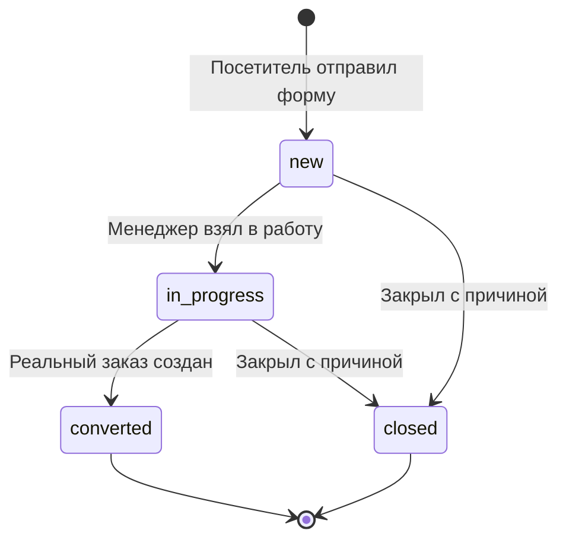

# Обращения покупателей LAVR

Проект от 20 октября 2026 года. Статус: согласован пользователем, реализован и проверен в локальной Docker-сборке. Реальные Telegram и 1С требуют настройки.

Посетитель оставляет контакты или запрос на сайте. Обращение сохраняется в PostgreSQL и появляется в CRM. Telegram-бот сообщает о новом обращении в канале команды с кнопкой на защищённую карточку сайта. Менеджер связывается с клиентом, ведёт обращение и создаёт из него заказ либо закрывает с указанным результатом. Дальнейшая работа с заказом идёт в существующей CRM заказов.

## Форма для посетителя

Два действия: **«Свяжитесь со мной»** и **«Оставить запрос»**. Первое название охватывает звонок, почту и мессенджер. Форма доступна гостям и пользователям с действующей или просроченной сессией; регистрация покупателя не требуется. Кнопки находятся в блоке помощи на главной и в контактах подвала на всех страницах.

| Поле | Свяжитесь со мной | Оставить запрос |
| --- | --- | --- |
| Имя | Необязательно, до 100 символов | Необязательно, до 100 символов |
| Телефон | Хотя бы один из трёх способов связи | Хотя бы один из трёх способов связи |
| Email | Хотя бы один из трёх способов связи | Хотя бы один из трёх способов связи |
| Мессенджер | Название сервиса и контакт | Название сервиса и контакт |
| Текст | Необязательный комментарий, до 2000 символов | Обязательный запрос, до 2000 символов |

Можно указать несколько контактов. Проверяется каждый заполненный контакт; ошибка одного не скрывается наличием другого. Телефон нормализуется в существующий российский формат `+7XXXXXXXXXX`, входное значение ограничено 30 символами. Email обрезается по краям, проверяется на сервере и ограничен 254 символами. Для мессенджера нужны название сервиса до 40 символов и идентификатор, телефон или ссылка до 254 символов; частично заполненная пара отклоняется. Контрольные символы и пустые значения после обрезки пробелов запрещены.

Мессенджер сохраняется как контакт, например «Telegram / @ivan» или «MAX / ссылка на профиль». Приложение проверяет заполненность и допустимый размер, но не подтверждает существование аккаунта или владение контактом. В карточке он отображается текстом с возможностью копирования; произвольная пользовательская ссылка не превращается в активный HTML. Сбор контакта MAX не требует подключения MAX-бота. Уведомления первого этапа идут в Telegram.

Одна форма открывается в существующем диалоге с переключением варианта и сохранением введённых контактов. На телефоне поля идут в одну колонку; область нажатия кнопок — от 44 px, шрифт полей — от 16 px. Нужны подписи, управление клавиатурой, фокус при открытии, Escape и возврат фокуса на вызвавшую кнопку. Ошибки объявляются через `role="alert"`, отправка и результат — через `role="status"`.

Во время отправки повторное нажатие отключено. При ошибке значения сохраняются, незавершённая форма остаётся в памяти вкладки. Подтверждение «Спасибо, мы свяжемся с вами» появляется после commit в БД; номер обращения в публичной форме не показывается. Оно не обещает срок ответа или доставку Telegram. После успеха доступна кнопка «Отправить ещё обращение»; закрытие и повторное открытие также показывают чистую форму с выбранным вариантом. Новая заявка получает новый ключ попытки, даже с теми же контактами; неуспешная сохраняет прежний ключ для безопасного повтора. Дополнительного TTL экрана успеха нет, серверное ограничение частоты сохраняется. Контакты и текст не сохраняются в localStorage или sessionStorage.

## Работа менеджера на сайте

В CRM появляется вкладка **«Обращения»**, доступная ролям `manager` и `admin`. Список показывает номер, время, вариант обращения, имя при наличии, короткий текст, доступные способы связи, статус и ответственного. Есть фильтр по статусу, поиск по номеру/контактам и существующая пагинация. По умолчанию новые обращения идут первыми; завершённые доступны в списке по фильтру.

Карточка показывает исходный запрос, все контакты, ответственного, статус, заметки и историю действий с датой и сотрудником. Для проверенного телефона и email доступны обычные действия звонка и письма; значения не могут добавлять произвольные параметры в `tel:` или `mailto:`. Мессенджер можно скопировать и открыть вручную. Автоматической отправки сообщений клиенту нет.

Любой менеджер или администратор может читать обращения. Действие **«Взять в работу»** назначает текущего сотрудника ответственным. После этого заметки, закрытие и создание заказа доступны ответственному и администратору. Два одновременных взятия не дают двух владельцев: версия записи проверяется атомарно, второй сотрудник получает конфликт и обновляет карточку. Открытие ссылки и чтение карточки не меняют статус и не назначают ответственного.

Менеджер фиксирует результат контакта заметкой и при необходимости указывает использованный способ связи. Заметки сохраняются в БД. Изменения статуса, ответственного и создание заказа фиксируются существующим аудитом; карточка объединяет их с заметками в историю. Переназначение между сотрудниками и отдельные роли операторов не требуются для первого этапа.

## Статусы и исходы

| Статус | Значение и доступные действия |
| --- | --- |
| `new` — Новое | Сохранено в БД; можно взять в работу или закрыть с причиной |
| `in_progress` — В работе | Есть ответственный; можно фиксировать контакт, добавлять заметки, подготовить заказ или закрыть |
| `converted` — Создан заказ | Терминальный исход обращения, есть ссылка на реально созданный заказ |
| `closed` — Закрыто без заказа | Терминальный исход с обязательной причиной: например, вопрос решён, дубль, клиент отказался или связь не состоялась |

Закрытие требует текстового результата до 2000 символов. Статус `converted` нельзя поставить обычным переключателем: его устанавливает только успешное создание связанного заказа. Терминальные обращения не возвращаются в работу. Последующая отмена или выполнение заказа изменяет заказ, сохраняя факт его создания из обращения.

## Подготовка и создание заказа

В карточке обращения в работе доступна кнопка **«Подготовить заказ»**. Менеджер ищет товары в существующем каталоге, выбирает количество и способ получения, указывает адрес при доставке. Имя, телефон и email подставляются из обращения, если они есть. Недостающие имя и телефон менеджер получает во время консультации: текущий заказ требует оба поля, хотя обращение может содержать только почту или мессенджер.

Подготовка заказа использует отдельную форму и список товаров внутри карточки. Она не изменяет покупательскую корзину, её черновик, квитанцию или ключ повтора оформления. Введённые данные сохраняются в форме при ошибке. Отдельное серверное хранение черновиков заказа не входит в первый этап.

Новый защищённый endpoint создания заказа из обращения использует существующую схему `CreateOrderRequest` и общую серверную логику заказа. В одной транзакции выполняются проверки цен и остатков, резервирование, создание `Order`, событие `order_export`, связь с обращением, переход в `converted`, увеличение версии и аудит. Ошибка откатывает всю операцию; создание заказа с последующей отдельной привязкой не применяется. Одно обращение создаёт не больше одного заказа, повтор той же попытки возвращает исходный результат.

После успеха карточка показывает номер и кнопку **«Открыть заказ»**. Заказ проходит обычный существующий процесс; `converted` означает создание локального заказа с заданием обмена, а не подтверждённую выгрузку или завершённую продажу.

Сохраняются действующие требования: реальные имя и российский телефон, товары каталога, допустимые количества, актуальная цена и остаток, адрес доставки при необходимости и настроенный адаптер 1С. Сейчас адаптер отключён: в рабочем API попытка создания заказа вернёт `503 ERP_NOT_CONFIGURED`; обращение останется в работе, а форма подготовки сохранит значения. Сам приём и обработка обращений от 1С не зависят.

## Telegram и ссылки на карточки

Подробный контур уведомлений сотрудникам, порядок подключения бота/канала и ограничения текущего worker: [проект интеграции Telegram](telegram-integration-design.md).

Каждое новое обращение создаёт отдельное сообщение в канале команды: номер, время по Москве, вариант обращения и кнопка **«Открыть обращение»**. Это последовательный список уведомлений. Полные контакты, текст и инструменты обработки находятся в защищённой карточке сайта. Смены статуса и создание заказа выполняются на сайте; Telegram не принимает эти команды.

Кнопка использует обычный `InlineKeyboardButton.url`. Для неё не нужны Telegram Login, Mini App или обработчик callback-команд. Боту требуется право публикации в канале. [URL кнопки Telegram](https://core.telegram.org/bots/api#inlinekeyboardbutton), [права администратора](https://core.telegram.org/bots/api#chatadministratorrights).

Ссылка на список: `/#crm-feedback`. На обращение: `/#crm-feedback?case=<UUID>`. На связанный заказ: `/#crm?order=<UUID>`. Это расширяет текущую hash-маршрутизацию без смены хостинга. Идентификатор обрабатывается отдельно от имени страницы: переход между карточками должен загружать новую карточку даже при той же вкладке CRM.

Если сотрудник не вошёл, сайт показывает существующий вход и после успеха открывает выбранное обращение или заказ. То же назначение сохраняется после истечения сессии и повторного входа. Карточка загружается по ID независимо от текущей страницы списка. Logout и переходы отменяют применение устаревших ответов. Несуществующая карточка показывает ошибку, а контакты не загружаются до успешной проверки прав.

Полная ссылка формируется из доверенного серверного `PUBLIC_SITE_URL`, а не из входного Host. В URL нет контактов, паролей, cookie или токена бота. Знание ссылки и участие в Telegram-канале не дают прав менеджера. Для работы с телефона сотрудника нужен доступный ему адрес сайта; `127.0.0.1` открывает сервис на устройстве, где нажата ссылка, и не публикует локальную машину в сети.

## API и права

| Endpoint | Назначение и защита |
| --- | --- |
| `POST /api/feedback` | Публичное создание, проверка Origin и лимитов, UUID `Idempotency-Key` |
| `GET /api/manager/feedback` | Список с фильтром, поиском и пагинацией; действующая сессия manager/admin |
| `GET /api/manager/feedback/{id}` | Карточка и история; действующая сессия; `ETag` |
| `POST /api/manager/feedback/{id}/notes` | Добавить заметку с выбранным способом связи при необходимости; ответственный/admin, Origin/CSRF, `If-Match` |
| `PATCH /api/manager/feedback/{id}/status` | Взять в работу или закрыть с причиной; права, Origin/CSRF, `If-Match` |
| `POST /api/manager/feedback/{id}/order` | Атомарно создать заказ и связь; ответственный/admin, Origin/CSRF, `If-Match`, отдельный `Idempotency-Key` |

Публичное тело содержит только `type: contact | request`, `name`, `phone`, `email`, `messenger: { service, address }`, `message`. Пустая пара полей мессенджера означает отсутствие этого контакта. Для `request` текст обязателен; для обоих вариантов требуется хотя бы один корректный способ связи. Лишние поля, клиентские статусы, роли и ID сотрудников отклоняются. Контакты однострочные; в сообщении, заметках и причине закрытия разрешены обычные переносы строк, но запрещены NUL и небезопасные управляющие символы. Cookie публичная форма не использует для доступа или привилегий.

После commit публичный endpoint возвращает `202` и `{ id, number, createdAt, state: "accepted" }`. Повтор той же нормализованной попытки возвращает ту же квитанцию, даже если менеджер уже изменил статус; приватные поля и связь с заказом не раскрываются. Повтор ключа с другим содержимым даёт `409`. В браузерном sessionStorage допустимы только технический UUID и SHA-256 отпечаток попытки под отдельным ключом, без контактов и текста.

Менеджерские изменения блокируют строку, проверяют версию и записывают изменение с аудитом в одной транзакции. Старая версия даёт `412`, запрещённый переход — `409`, отсутствие входа — `401`, недостаточные права — `403`. При конфликте UI сохраняет незаписанный текст и предлагает загрузить актуальную карточку.

Повтор успешной конверсии проверяется после авторизации, но до сравнения устаревшей версии и проверки ERP. На обращении сохраняются ключ, отпечаток и исходная квитанция конверсии; другой payload с тем же ключом даёт конфликт. Новая попытка после успешной конверсии не создаёт второй заказ и указывает на существующую связь. Публичный ключ создания обращения, ключ покупательского оформления и ключ его конверсии разделены.

Новые публичные обращения ограничены общим PostgreSQL-счётчиком: 10 с одного IP за 10 минут и 3 на каждый указанный контакт за 10 минут. Ключи контактов — HMAC, повтор сохранённой попытки не расходует лимит. Адрес клиента берётся только от доверенного прокси; входная цепочка `X-Forwarded-For` не считается достоверной. Ответ `429` содержит `Retry-After`. Приватные ответы имеют `Cache-Control: no-store`; публичного чтения обращений нет.

## Хранение и уведомления

Таблица `feedback` хранит исходную форму, номер, время создания/обновления, статус, nullable `assigned_staff_id`, версию, результат закрытия и nullable уникальный внешний ключ `order_id` с запретом удаления связанного заказа. В БД действует соответствие: `converted` тогда и только тогда, когда есть связь с заказом. Заметки с автором и временем хранятся в отдельной таблице; статусы и действия — также в существующем аудите. Исходный запрос не подменяется данными заказа.

Создание обращения и одного события `feedback_telegram` в существующем outbox выполняется в одной транзакции. ID события совпадает с ID обращения, payload содержит только его ID. Новые nullable поля `next_attempt_at` и `last_error_code` сохраняют совместимость с событиями заказов. Новые модели регистрируются в Alembic и тестовых fixtures; исходная миграция не переписывается.

Отдельный процесс из существующего backend-образа читает только `feedback_telegram`. В Compose у него собственная команда вместо Uvicorn, ожидание готовности backend после миграций и `restart: unless-stopped`. Унаследованная HTTP-проверка здоровья backend отключена для worker через `healthcheck: { disable: true }`, поскольку он не поднимает HTTP-сервер; штатный запуск с `--wait` учитывает работающий процесс. PostgreSQL служит очередью без дополнительного брокера. Обработчик занимает строку на ограниченный срок, освобождает транзакцию перед сетью и проверяет владельца попытки при записи результата. Сетевой timeout короче аренды; запоздавший процесс не перезаписывает новую попытку. События 1С не обрабатываются этим процессом.

После подтверждённой отправки событие получает `done`. Временные сбои повторяются через 5 секунд, 30 секунд, 2 минуты, далее 15 минут; при `429` учитывается `retry_after`. Ошибки токена и прав сохраняются безопасным кодом и перепроверяются не чаще раза в 15 минут после исправления. Отправки в один канал ограничены одной в секунду. Журналы не содержат токенов, URL с токеном, контактов или текста. [Telegram sendMessage](https://core.telegram.org/bots/api#sendmessage), [ограничения отправки](https://core.telegram.org/bots/faq#my-bot-is-hitting-limits-how-do-i-avoid-this).

При неоднозначном timeout Telegram может получить повтор уведомления: Bot API не документирует идемпотентность `sendMessage`. Номер обращения позволяет распознать дубль; сама заявка и её заказ не дублируются благодаря транзакциям и ключам попытки.

`TELEGRAM_BOT_TOKEN`, `TELEGRAM_CHAT_ID` и `PUBLIC_SITE_URL` задаются на сервере. Если уведомления не настроены, заявки всё равно принимаются в БД и видны менеджеру, а события ждут настройки. Ошибка Telegram также не блокирует CRM. В карточке виден безопасный статус уведомления: ожидает, отправлено или требует внимания. Приём завершается ошибкой только если сам запрос невалиден, ограничен или не может быть сохранён.

Автоматическая очередь включается отдельно через `TELEGRAM_NOTIFICATIONS_ENABLED=true`; по умолчанию она выключена. Серверные команды `python -m app.telegram_cli check` и `test` позволяют проверить канал и отправить одно техническое сообщение без запуска старых уведомлений. Общая пауза `429` хранится в БД; порядок подключения описан в [инструкции Telegram](telegram-integration-design.md#подключение-своего-тестового-канала).

## Область реализации

| Часть | Изменения |
| --- | --- |
| Посетитель | `src/App.vue`, `LandingPage.vue`, `styles.css`: форма, контакты, состояния и доступность |
| Менеджер | Новый `FeedbackManager.vue`: список, карточка, заметки, статусы и подготовка заказа; App.vue расширяет маршруты и сохраняет назначение через вход |
| Данные frontend | HTTP/demo API для обращений и конверсии; отдельные технические ключи попыток без изменения покупательской корзины |
| Backend | Новый `feedback.py` и worker, подключение в `main.py`, настройки, два поля Outbox; действующие auth/common/audit используются без ослабления |
| Заказы | Выделение минимальной общей транзакционной функции создания в `orders.py`, без внутреннего commit; публичное оформление сохраняет текущие схемы, ответы, идемпотентность и проверки |
| База и запуск | Новая миграция, регистрация моделей и fixtures, Compose worker и серверные примеры настроек, доверенный прокси |
| Документация и проверки | OpenAPI, README, серверные, HTTP/demo и браузерные тесты |

Новые зависимости, брокер, покупательские аккаунты, вложения, автоматическая переписка с клиентом, переназначение сотрудников, повторное открытие терминальных обращений, отдельные серверные черновики заказа и MAX-уведомления не входят в первый этап. В демо результаты явно помечены как демонстрационные и не обещают реальную доставку.

## Критерии приёмки

1. Контакт без текста и запрос с текстом принимаются с одним телефоном, одним email, одним мессенджером или несколькими контактами. Пустые и некорректные заполненные контакты отклоняются. Вход посетителя не требуется.
2. Обращение и уведомление записываются атомарно; повтор и конкурентные одинаковые попытки не создают дубли. После изменения статуса публичный повтор не раскрывает данные карточки. Перезапуск контейнеров сохраняет обращения, заметки, связи и очередь.
3. Без бота и 1С обращения доступны для приёма и работы. При сбое Telegram они остаются в CRM. Проверяются повтор, `429`, неверный токен, истечение аренды и ответ запоздавшего обработчика; события 1С остаются нетронутыми.
4. Кнопка Telegram ведёт на конкретную карточку; гость проходит вход и попадает туда же. Проверяются новая вкладка, переход между карточками, истечение сессии, отсутствие прав, неизвестный ID и ссылка на связанный заказ вне текущей страницы списка.
5. Нельзя получить чужие приватные данные без роли. Два менеджера не занимают обращение одновременно. Только ответственный/admin меняет занятое обращение. Закрытие требует причины, запрещённые переходы и ручной `converted` отклоняются.
6. Подготовка заказа подставляет контакты, требует недостающие данные, позволяет выбрать товары и получение, сохраняет форму при ошибке и не меняет покупательскую корзину.
7. С тестовым ERP-адаптером заказ, резерв, outbox и связь создаются вместе; проверяются повторы, конкуренция с закрытием, две попытки конверсии и откат. При отключённой 1С реальный API даёт `503`, оставляя обращение в работе. Существующие тесты оформления заказа проходят без изменения ожидаемого поведения.
8. Браузерные сценарии проверяют ошибки, двойной клик, фокус, клавиатуру, мобильные 320/390 px, прямые ссылки после входа и сохранность черновиков при сетевых ошибках. В ответах и журналах нет токенов и данных других обращений.

Живая проверка канала выполняется после настройки бота и доступного адреса сайта; автоматические проверки используют тестовый Telegram-транспорт и отдельную тестовую БД.
