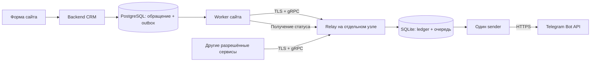

# Telegram relay и подключение уведомлений сайта

Дата: 28 октября 2026 года. Статус: проект для рассмотрения; архитектурные решения ниже — рекомендации автора, а не согласованная или развёрнутая система. Код, сервер и действующие настройки этим документом не меняются.

## Задача и текущие ограничения

Отдельный сервис принимает уведомления внешних приложений по gRPC, сохраняет их и отправляет в разрешённые Telegram-каналы. Первое приложение — MIRZAP67: уведомление о новом обращении и кнопка защищённой карточки CRM.

По результатам предшествующей диагностики VM `157.228.139.156` не устанавливает TCP-соединение с Telegram на порту 443 по IPv4/IPv6, хотя доступ к PyPI работает. Это исходное наблюдение, не повторная проверка в рамках документа. Дополнительный контейнер на той же VM сам по себе ограничение не устранит: relay размещается на отдельном узле с проверенным выходом к Telegram и доступным сайту gRPC endpoint.

В текущем сайте уже реализованы атомарное сохранение обращения и события `feedback_telegram`, PostgreSQL outbox, worker с арендой задания, повторные попытки, `uncertain` и сохранённая пауза `429`. Публичный ответ формы подтверждает сохранение обращения, независимо от Telegram. Этот порядок сохраняется.

V1 обслуживает только уведомления сотрудникам. В запросах нет клиентских контактов, текста обращения, кодов подтверждения или секретов. Клиентские OTP, email, SMS, платная доставка, входящие сообщения и произвольные вызовы Bot API требуют отдельных контрактов и сюда не входят.

## Подходы и выбранная рекомендация

| Подход | Выигрыш | Ограничение |
| --- | --- | --- |
| gRPC relay + SQLite на отдельном узле | Один небольшой сервис, долговечная очередь, минимум эксплуатации | Одна реплика, локальный постоянный диск, резервное копирование |
| gRPC relay + собственный PostgreSQL | Удобен при уже существующей БД или нескольких worker | Дополнительная эксплуатация и сетевые зависимости |
| Прямой HTTP proxy для текущего worker | Меньше изменений для одного сайта | Не даёт запрошенного общего gRPC-контракта и авторизации внешних сервисов |

Рекомендация V1: один relay instance с SQLite. Брокер сообщений не нужен: source outbox защищает сохранение до передачи, ledger relay — после передачи; идемпотентный RPC закрывает разрыв между этими транзакциями. При дальнейшем переходе на PostgreSQL внешний контракт сохраняется. Базу CRM наружу ради relay не открывать.



## Доверие и назначение

- gRPC доступен только по TLS с проверкой сертификата сервера. Каждый сервис получает отдельный случайный секрет в metadata `authorization: Bearer ...`; на relay хранится его проверочное значение. Общий секрет всех клиентов запрещён. Ротация допускает краткое пересечение старого и нового ключа. TLS и credentials в metadata поддерживаются самим [gRPC](https://grpc.io/docs/guides/auth/).
- `source_id` определяется проверенным credential, а не полем сообщения. ACL разрешает источнику `mirzap67` только alias `mirzap67.staff`; чтение чужих статусов запрещено. Будущим источникам выдаются собственные ACL и лимиты.
- Первый alias: `mirzap67.staff` → серверная конфигурация бота и канала `-1003744016989`. Боту требуется право публикации. Присутствие alias в проекте не подтверждает доступность канала или права бота.
- Клиент не передаёт `chat_id`, токен бота, URL Bot API, имя его метода, HTML/Markdown или raw JSON. Relay разрешает только `sendMessage` в рамках этого контракта.
- При принятии фиксируются идентификатор бота и числовое назначение/ревизия alias. Изменение alias не перенаправляет уже принятую очередь. Секрет токена не копируется в задания; его ротация сохраняет тот же идентификатор бота.

## Предлагаемый контракт V1

Ниже полное определение сообщений контракта; файл `.proto`, generated clients и зависимости пока не создаются. Номера полей после публикации не переиспользуются; несовместимые изменения получают новый package.

```proto
syntax = "proto3";
package notifications.v1;

import "google/protobuf/timestamp.proto";

service NotificationRelay {
  rpc SubmitNotification(SubmitNotificationRequest) returns (NotificationReceipt);
  rpc GetNotification(GetNotificationRequest) returns (NotificationReceipt);
}

message SubmitNotificationRequest {
  string request_id = 1;
  google.protobuf.Timestamp request_created_at = 2;
  string destination_alias = 3;
  string text = 4;
  Button button = 5;
}

message Button {
  string label = 1;
  string url = 2;
}

message GetNotificationRequest {
  string notification_id = 1;
}

enum NotificationState {
  NOTIFICATION_STATE_UNSPECIFIED = 0;
  QUEUED = 1;
  SENDING = 2;
  RETRY_WAIT = 3;
  UNCERTAIN = 4;
  TELEGRAM_ACCEPTED = 5;
  FAILED = 6;
}

message NotificationReceipt {
  string notification_id = 1;
  NotificationState state = 2;
  google.protobuf.Timestamp accepted_at = 3;
  google.protobuf.Timestamp updated_at = 4;
  google.protobuf.Timestamp next_attempt_at = 5;
  string safe_error_code = 6;
  optional int64 telegram_message_id = 7;
  bool duplicate_possible = 8;
}
```

`request_id` — UUID. Источник создаёт его и `request_created_at` один раз, сохраняет до первого RPC и повторяет неизменно. Для сайта ID равен ID события outbox; время команды фиксируется при подготовке первой передачи, а не берётся заново на каждом повторе. Поэтому старые обращения могут быть переданы после явного включения очереди.

Уникальный ключ ledger — `(authenticated_source_id, request_id)`. Сервер хранит digest нормализованных смысловых полей запроса, включая timestamp; сериализация protobuf сама по себе не служит каноническим форматом. Повтор с тем же содержимым возвращает ту же запись и её текущий статус; изменённое содержимое — `ALREADY_EXISTS`. Чужой источник не может прочитать или изменить запись.

`SubmitNotification` отвечает успешно только после commit ledger; первый статус обычно `QUEUED`. Ответ означает долговечное принятие relay. `TELEGRAM_ACCEPTED` появляется только после успешного Bot API ответа и сохранения положительного `message_id`. Он подтверждает принятие сообщения Telegram, но не прочтение сотрудником.

Клиент задаёт deadline каждого RPC: предлагается 5 секунд для Submit и 3 секунды для Get, с дальнейшей проверкой на реальной сети. У gRPC нет deadline по умолчанию, поэтому неограниченное ожидание недопустимо ([документация](https://grpc.io/docs/guides/deadlines/)). Прекращение RPC после commit не отменяет принятую отправку: клиент повторяет тот же Submit. Telegram вызывается отдельным sender и не входит в длительность Submit.

## Валидация, ошибки и сроки

- Предлагаемые лимиты: gRPC message до 32 KiB; текст от 1 до 4096 Unicode-символов; alias до 80 ASCII-символов; подпись кнопки 1–64 символа; URL до 2048 байт. Управляющие символы запрещены, кроме переводов строки в тексте; на граничных Unicode-строках не превышать лимит Bot API. Текст не обрезается молча.
- Кнопка либо отсутствует, либо содержит оба поля. URL — только HTTPS, без userinfo и секретов, с origin из allowlist источника. Для `mirzap67` разрешён только настроенный публичный origin CRM и маршрут `/#crm-feedback?case=<UUID>`. Relay не загружает ссылку; previews отключены. Точные origin и DNS endpoint задаются при развёртывании.
- `INVALID_ARGUMENT`: неверные поля/размер; `UNAUTHENTICATED`: credential; `PERMISSION_DENIED`: alias/ACL; `ALREADY_EXISTS`: конфликт ключа; `NOT_FOUND`: отсутствующая или чужая запись; `RESOURCE_EXHAUSTED`: входной лимит/заполненная очередь; `UNAVAILABLE`: нет долговечного хранилища. Подробности не раскрывают секреты или чужие данные.
- Предлагается максимум 10 000 незавершённых заданий на источник и 5 входных Submit в секунду с burst 10. Это защитные значения V1, а не обещанный throughput Telegram. Идемпотентные повторы также ограничиваются на входе.
- Предлагаемое окно команды — 7 суток от `request_created_at`, допустимое опережение часов — 5 минут. Неизвестный старый запрос отклоняется `FAILED_PRECONDITION/REQUEST_EXPIRED`; существующий возвращается в пределах срока хранения. Источник ограничивает автоматические повторы передачи тем же окном.
- Неподтверждённая доставка прекращает автоматические попытки через 7 суток от времени команды и получает `FAILED/DELIVERY_EXPIRED`; обращение остаётся в CRM. После устранения длительного сбоя повтор требует явной новой команды и нового ключа с аудитом.
- Через 30 суток после завершения payload удаляется, остаётся tombstone: источник, ключ, digest и полная итоговая receipt, включая `message_id` при успехе. Ещё через 30 суток tombstone удаляется; status lookup возвращает `NOT_FOUND`. Исходный запрос к этому времени старше окна и не отправляется снова. Эти сроки требуют согласования перед реализацией.
- После timeout, `DEADLINE_EXCEEDED`, `UNAVAILABLE` или потери соединения клиент не знает, был ли commit: повторяет тот же запрос с backoff и jitter, не создаёт новый ключ. Ошибки Telegram не становятся транспортной ошибкой уже принятого Submit, а отражаются в статусе.

## Ledger и отправка

SQLite хранится на локальном постоянном volume, с WAL и `synchronous=FULL`; транзакции короткие, сетевого вызова внутри них нет. Один экземпляр сервиса и один sender владеют очередью. Контейнерный filesystem и сетевой filesystem для БД не подходят. Резервная копия делается штатным SQLite backup API с проверкой восстановления.

Одна таблица заданий содержит ключ источника, digest, payload, закреплённое назначение, состояние, попытки, lease/fencing token, время следующей попытки, безопасный код, `message_id` и сроки. Вторая хранит паузы отправки; tombstone может оставаться строкой первой таблицы без payload. Секреты отделены от ledger.

Sender атомарно занимает due-запись на 60 секунд, сохраняет попытку и fencing token, затем вызывает Telegram с timeout 10 секунд. Результат записывается только при совпадении владельца попытки. Поздний процесс не меняет новую попытку. После перезапуска истёкший `SENDING` считается неопределённым: отправка могла состояться.

Повторы: 5 секунд, 30 секунд, 2 минуты, далее 15 минут с jitter. Ошибки конфигурации/прав сохраняются как безопасный код, повторяются не чаще раза в 15 минут и требуют внимания оператора. До исправления неисправного бота остальные задания этого бота не отправляются. Неустранимое нарушение принятого контракта завершает запись `FAILED`.

Один sender ограничивает отправку в первый канал одной попыткой в секунду. `429` сохраняет `retry_after` и паузу всего затронутого бота, включая другие aliases этого бота; рестарт паузу не снимает. Дополнительные типы чатов требуют проверки их ограничений до подключения. Увеличение числа sender требует общего rate limiter, а не только row leases.

Timeout, потеря ответа, некорректный ответ после отправки или падение до commit результата переводят запись в `UNCERTAIN`. Последующий повтор может создать дубль; `duplicate_possible` после первой неоднозначной попытки сохраняется навсегда. Bot API не предоставляет требуемой здесь идемпотентности `sendMessage`; exactly-once не обещается.

Инварианты: `TELEGRAM_ACCEPTED` и `FAILED` терминальны; успешный статус обязательно содержит сохранённый `message_id`; до успеха его нет; `FAILED` после неопределённой попытки не означает, что сообщение точно не отправилось. Текущий `SENDING` не подтверждает доставку. Номер обращения в тексте позволяет сотруднику распознать дубль.

Журналы и метрики содержат source, ID, alias, состояние, задержку и безопасный код; без credentials, payload и URL Bot API. Нужны размер/возраст очереди, время последнего успеха, ошибки, неопределённые исходы и оставшаяся пауза. Readiness проверяет возможность commit ledger; сбой Telegram показывает деградацию доставки, сохраняя возможность принимать очередь в пределах лимита.

## Подключение сайта и отображение статуса

1. Публичный `POST /api/feedback` по-прежнему сохраняет обращение и outbox одной транзакцией. Вызов relay не выполняется из пользовательского HTTP-запроса и не меняет его успешный ответ.
2. Worker сайта собирает прежний короткий текст и кнопку из доверенного `PUBLIC_SITE_URL`, но передаёт alias вместо Telegram `chat_id`. В канал не попадают имя, телефон, email, messenger или текст обращения.
3. До первого Submit worker сохраняет `relay_request_created_at` и неизменяемый snapshot всего запроса в существующем JSONB payload outbox; ID запроса равен ID outbox. После ответа сохраняет `relay_notification_id`. Если ответ потерян, повторяет сохранённый Submit, даже после смены origin/alias в конфигурации; после получения ID использует Get.
4. Успешное принятие relay не завершает source outbox. `done` ставится только после `TELEGRAM_ACCEPTED`; pending/retry состояния продолжают проверяться с backoff. Relay один отвечает за Telegram-повторы, сайт — за передачу и получение статуса.
5. Перед первым переключением остановить прямой Telegram worker, учесть уже завершённые и неопределённые задания и явно решить судьбу старой очереди. Завершённые не переотправляются; старые ожидающие отправляются только после осознанного включения. Нельзя одновременно включать прямую и relay-отправку одного события.

| Relay / соединение | HTTP notification сайта | Подпись CRM |
| --- | --- | --- |
| До передачи, `QUEUED`, `RETRY_WAIT` | `queued` | Ожидает отправки |
| `SENDING` | `running` | Отправляется |
| `TELEGRAM_ACCEPTED` | `done` | Отправлено |
| `UNCERTAIN` | `uncertain` | Доставка не подтверждена |
| `FAILED`, недоступный relay, истёкший lookup | `error` | Требует внимания |
| Не настроены endpoint/credential/alias/origin | `not_configured` | Ожидает настройки уведомлений |

Потеря Get не стирает ранее подтверждённый успех; до успеха сохраняются последнее известное состояние, безопасный код связи и время проверки. В частности, недоступность Get после `UNCERTAIN` не превращается в утверждение об отсутствии доставки. `FAILED`, истечение окна и `NOT_FOUND` после передачи останавливают автоматическую обработку source outbox: его уже допустимое внутреннее состояние `rejected` проецируется в HTTP `error`. Новая отправка требует явного решения, не нового автоматического ключа. Браузер не получает credential relay или Bot API.

## Область реализации, миграция и приёмка

- Новый самостоятельный сервис: `.proto`, generated clients, gRPC/TLS server, credential/ACL config, SQLite migration, sender, диагностика, backup/runbook и контейнер. Язык рекомендуется Python для повторного использования поведения существующего transport; зависимости выбираются и фиксируются только при реализации.
- Сайт: `backend/app/notification_worker.py`, `feedback.py`, `integration.py`, `config.py`, новая Alembic migration и gRPC client. Минимум nullable полей outbox: `relay_request_created_at`, `relay_notification_id`; при наблюдении статуса сохраняются время проверки и безопасная ошибка связи. Исторические `done` не меняются. Первый rollout добавляет поля до переключения worker.
- Конфигурация сайта: `NOTIFICATION_RELAY_TARGET`, `NOTIFICATION_RELAY_TOKEN`, `NOTIFICATION_DESTINATION_ALIAS=mirzap67.staff`, TLS trust и прежние `PUBLIC_SITE_URL`/флаг включения очереди. Настройки передаются только backend/worker, не `VITE_*`. Bot token и chat ID после перехода нужны только relay, из конфигурации сайта удаляются; CLI проверки переводится на relay без обхода ACL.
- Изменяются Compose/env examples, packaging/scripts, server runbook и документация интеграции. Существующие HTTP notification states сохраняются; корректируются проверка конфигурации и подпись `not_configured`. Строгий frontend validator и demo API должны остаться совместимыми. Старый способ отправки при откате допустим только после остановки relay и сверки принятых заданий; уже принятую очередь нельзя безопасно считать неотправленной.
- Проверки relay: auth/ACL и чужие ID; валидность URL/размеров/Unicode; одинаковый ключ у разных источников; совпадающий/конфликтующий повтор; commit с потерянным ответом; crash/restart/lease fencing; `429` между aliases одного бота; timeout с дублем; истечение команды; очистка payload/tombstones; восстановление SQLite backup. Необходимы отдельные проверки границ 7/30/60 суток и будущего timestamp.
- Проверки сайта: сохранение формы без relay; повтор Submit после потерянного ответа; отсутствие `done` на одном принятии relay; восстановление статуса после рестарта; сохранение `uncertain`; legacy outbox и исключение событий 1С; безопасные логи; точная карточка после входа; прежние backend/frontend tests, fixtures, OpenAPI и browser smoke.
- Перед production нужны проверенный новый узел/endpoint, секреты источника, TLS, доступ relay к Telegram, проверка bot/channel/прав и одно явно разрешённое техническое сообщение. Затем синтетическое обращение должно пройти от commit CRM до сохранённого `message_id` и открытия защищённой карточки с телефона. Наличие документа или unit tests этого не подтверждает.

До реализации остаётся выбрать узел/DNS и подтвердить предложенные сроки, лимиты и порядок обработки накопленных уведомлений. Реальная отправка, размещение сервиса, зависимости и изменения сайта этим проектом не выполнялись.

Уточнение V1 при реализации: после аутентификации и ограничения частоты совпавший сохранённый request_id/digest возвращает прежнюю receipt до проверки текущей ACL/origin-политики; разрешение нового запроса не требуется для чтения собственного принятого результата. Новый payload с тем же ключом конфликтует. Для дополнительных источников кнопка содержит HTTPS origin и path без query/fragment; MIRZAP67 сохраняет единственное строго проверяемое исключение /#crm-feedback?case=<UUID>. Это ограничение не пытается классифицировать произвольные секреты внутри path; источник обязан передавать только безопасные ссылки.
