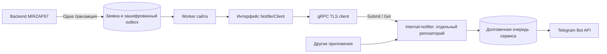

# internal-notifier: граница сервиса и подготовка приложения

Статус: дизайн согласован пользователем29.10.2026; подготовка клиента и ссылок одобрена. Сервис реализуется и выпускается в другом репозитории. Этот документ дополняет прежний [контракт relay](2026-10-28-telegram-relay-design.md), а не объявляет сервис подключённым.

## Задача и подход

MIRZAP67 и другие разрешённые приложения передают уведомления в единый internal-notifier, который доставляет их Telegram-ботом. Сайт подтверждает приём заявки после собственной транзакции; доступность Telegram не определяет успех формы. В CRM не передаются права управления произвольными ботами/чатами.

Подход сохраняет ранее выбранный gRPC и уже реализованный PostgreSQL outbox. Существующий TLS-клиент и protobuf позволяют подготовить переход без новой шины сообщений. REST потребовал бы второго контракта и повторной проверки идемпотентности; брокер добавил бы инфраструктуру без устранения уже закрытого outbox разрыва. Эти альтернативы для данного этапа не выбираются.



## Владение кодом

В этом приложении остаются:

- определение клиентского интерфейса и запроса, protobuf SDK с зафиксированной версией контракта;
- клиент gRPC/TLS, настройка endpoint/credential/destination alias;
- формирование безопасного текста и ссылки из бизнес-события;
- собственный outbox/worker, повторы передачи и отображение статуса доставки;
- тесты клиента, идемпотентного запроса и совместимости ссылок.

Репозиторий internal-notifier владеет сервером gRPC, проверкой источников/ACL, alias→бот/чат, секретом бота, долговечной очередью, Telegram sender, rate limits, backup/retention и deployment. Сайт не подключается к БД сервиса; сервис не получает CRM-БД и ключи ПДн.

В текущем репозитории уже есть прежняя реализация `telegram_relay.py`, `notification_ledger.py`, `compose.relay.yaml` и серверные тесты. При этой подготовке новая серверная функциональность туда не добавляется. Они фиксируются как legacy/reference для передачи: внешний репозиторий получает контракт и самостоятельный сервисный код, а удаление старых серверных файлов/Compose из приложения выполняется отдельным шагом после проверенного handoff. Путь/remote нового репозитория не задан; создавать его или развёртывать сервис в рамках подготовки клиента не требуется. Исполняемый сервер internal-notifier здесь не создаётся.

## Совместимый контракт V1

Канонический файл уже существует: [notifications.proto](../../../backend/app/notification_protocol/notifications.proto). Название процесса/репозитория `internal-notifier` не меняет wire package `notifications.v1` и service `NotificationRelay`.

| RPC | Запрос | Результат |
| --- | --- | --- |
| `SubmitNotification` | `request_id`, `request_created_at`, `destination_alias`, `text`, необязательная `button{label,url}` | Долговечно сохранённый `NotificationReceipt` |
| `GetNotification` | `notification_id` | Последнее известное состояние той же записи |

Существующие protobuf field numbers, enum numbers и типы сохраняются. Источник определяется credential, а не присланным `source_id`. Адресат — `mirzap67.staff`, числовой chat_id и bot token принадлежат конфигурации сервиса. Запрос не принимает raw Bot API, HTML/Markdown, секреты или клиентские контакты.

Состояния: `QUEUED`, `SENDING`, `RETRY_WAIT`, `UNCERTAIN`, `TELEGRAM_ACCEPTED`, `FAILED`. Принятие в очередь не означает отправку. Только `TELEGRAM_ACCEPTED` с положительным `telegram_message_id` позволяет источнику поставить `done`; это не подтверждение прочтения человеком. Неизвестное состояние или некорректный ответ — безопасная ошибка клиента. `duplicate_possible` и ранее известная неопределённость не теряются при временной ошибке наблюдения.

Предлагаемый минимальный локальный интерфейс — новый `backend/app/notifier.py`, без второго SDK или дублирующей модели receipt:

```python
class NotificationButton(TypedDict):
    label: str
    url: str

class NotificationRequest(TypedDict):
    request_id: str
    request_created_at: str  # существующий ISO timestamp сохранённого snapshot
    destination_alias: str
    text: str
    button: NotRequired[NotificationButton]

class NotifierClient(Protocol):
    def submit(self, request: NotificationRequest, /) -> NotificationReceipt: ...
    def get(self, notification_id: str) -> NotificationReceipt: ...
    def close(self) -> None: ...
```

`NotificationReceipt` здесь — существующий generated protobuf тип. `submit` в порте принимает запрос позиционно, сохраняя существующее имя `snapshot` у `RelayClient.submit`. `RelayClient` структурно реализует этот интерфейс; worker использует существующую injectable client factory. Публичные имена/аргументы существующих функций сохраняются для совместимости. Внешний репозиторий публикует версию `.proto`/SDK; обновление проверяется контрактными тестами. Пример payload, не дополнительный формат wire:

```json
{
  "request_id": "<UUID события outbox>",
  "request_created_at": "2026-10-29T09:00:00+00:00",
  "destination_alias": "mirzap67.staff",
  "text": "Новое обращение № F-...\n29.10.2026 12:00 МСК\nОставить запрос",
  "button": {
    "label": "Открыть обращение",
    "url": "https://mirzap67.ru/#crm-feedback?case=<UUID>"
  }
}
```

Текст не содержит имени, телефона, email, исходного сообщения, адреса, пароля или кода активации. Новый интерфейс допускает ссылку на заказ/раздел, но данный этап не включает новые автоматические триггеры уведомлений о заказах или смене статуса.

## Доставка и доверие

- Сохранить событие и его неизменяемый snapshot до первого RPC. `request_id` равен ID события, время команды фиксируется один раз; все повторы передают те же смысловые поля. Текущие JSON keys `relay_request`, receipt metadata и event type `feedback_telegram` не переименовываются.
- На сервисе уникален `(authenticated_source, request_id)`: тот же digest возвращает ту же запись; изменённое содержимое — конфликт. Ответ Submit только после durable commit. После получения receipt источник вызывает Get, не создаёт новое уведомление.
- Сохранить существующие lease/fencing, предел7дней для новой передачи, immutable destination и правила terminal/uncertain. Общий backoff после Telegram429 относится к sender сервиса. Неоднозначный сетевой исход не даёт обещания exactly-once.
- TLS с проверкой сертификата; отдельный Bearer credential каждому источнику, ACL на назначения и чтение своих receipt. В журнале нет credentials, текста сообщения или полных ссылок с приватными ID.
- Существующие пределы: RPC32KiB, текст1–4096 Unicode-символов и не более4096 UTF-16 units, label1–64символа, URLдо2048байт; plain text, одна кнопка, запрещённые управляющие символы отклоняются.
- Для MIRZAP URL строится из доверенного `PUBLIC_SITE_URL`, а не Host/пользовательского поля. Внешний сервис принимает только HTTPS origin и перечисленные безопасные маршруты из [дизайна ссылок](2026-10-29-direct-links-design.md). Без userinfo, внешних redirect, токенов и произвольных query. Старый feedback URL остаётся допустимым. Текущая legacy allowlist принимает только feedback UUID и должна быть расширена во внешнем сервисе до запуска новых назначений.
- CRM outbox зашифрован. Текущий reference ledger SQLite хранит payload открытым текстом; шифрование хранилища notifier не заявляется. Контракт запрещает ПДн в сообщениях, внешняя реализация явно описывает свой storage/backup policy. Нет универсальной автоматической проверки текста на все виды ПДн.

## Переход

1. Подготовить типизированный порт, типизировать существующий клиент/factory, централизовать builder безопасных ссылок; оставить текущую отправку выключенной.
2. Сохранить параметры `NOTIFICATION_TRANSPORT=direct|relay`, `NOTIFICATION_RELAY_TARGET`, `NOTIFICATION_RELAY_TOKEN`, `NOTIFICATION_RELAY_CA_FILE`, `NOTIFICATION_DESTINATION_ALIAS`. Новое имя сервиса не становится новым transport value. Неизвестное значение transport должно отклоняться, а не выбирать direct.
3. Реализовать/развернуть internal-notifier в другом репозитории и на узле с проверенным доступом к Telegram. Предыдущая диагностика выявила проблему доступа с VM CRM; в этом проектировании сеть повторно не проверяется.
4. Проверить TLS/ACL/Submit-replay/Get/UNCERTAIN/accepted без реального Telegram, затем отдельно согласованный технический send. Контрактные тесты на клиенте используют stub и тестовую TLS-точку, не реальный канал.
5. Сверить накопленные queued/uncertain события и destination policy; включение worker может отправить старые заявки. Не пересоздавать их ID и не переписывать уже принятые snapshots.
6. Явно переключить источник в relay. Для сохранённого relay snapshot нет прямого fallback даже при последующей смене режима; receipt означает, что повторную отправку ведёт сервис. Ротация endpoint/credential для принятых jobs требует предусмотренной сверки.
7. После проверки внешнего сервиса убрать legacy серверные reference-файлы из runtime поставки приложения и завершить вывод bot credentials из конфигурации сайта. Автоматический откат relay→direct с возможными дублями не выполняется.

## Проверки подготовки

Проверить тип/shape запроса и отсутствие CRM моделей в клиентском порту; реальный generated gRPC/TLS с заглушкой; повтор того же ID/digest; polling без повторного Submit; положительный message ID только в accepted; сохранение uncertain при ошибке CA; отсутствие direct fallback; отказ неизвестного transport; совместимость старых outbox keys и URL. При проверке кода реальные отправки и production-флаги не меняются.
