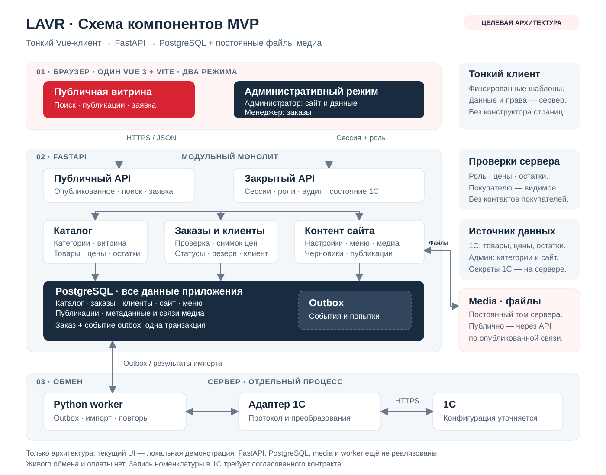
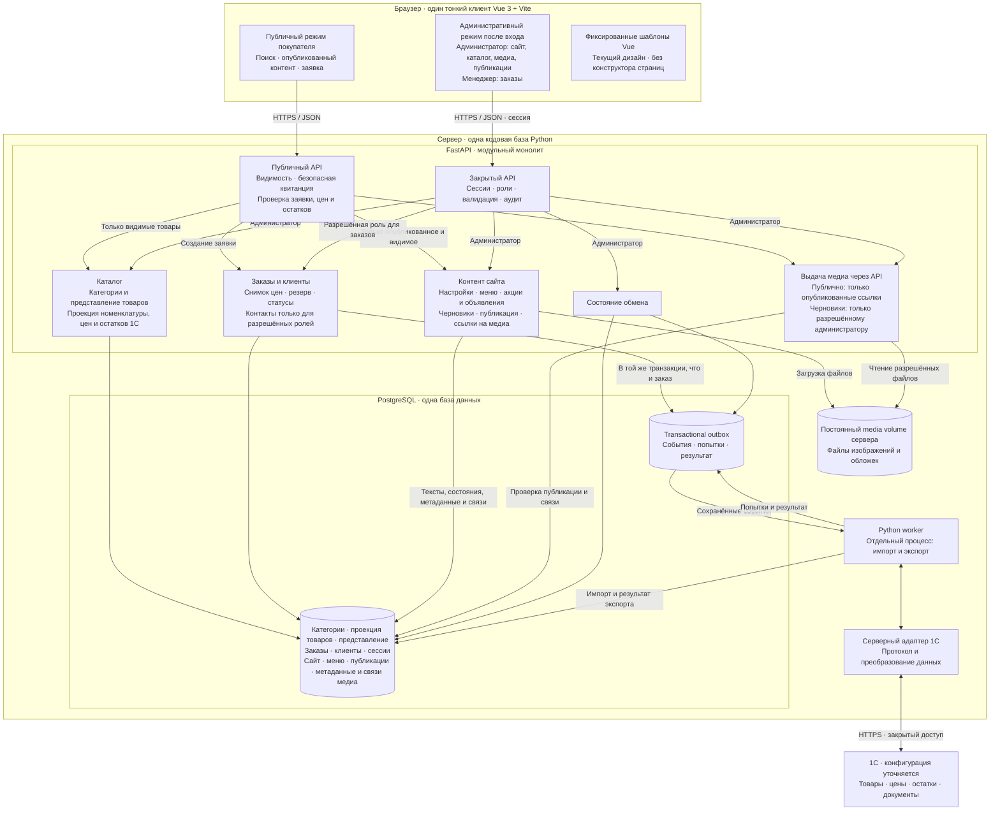

# Схема компонентов LAVR

Это схема **целевой рабочей системы** на FastAPI + Vue 3 / Vite. Vue — тонкий клиент с двумя режимами: публичная витрина для поиска и заявки и административный интерфейс после входа для управления данными и оформлением сайта. Все постоянные данные и проверки находятся на сервере. Шаблоны страниц заданы в Vue и сохраняют текущий дизайн; конструктора страниц нет.

**Сейчас реализована локальная серверная сборка:** Vue/Nginx, FastAPI и PostgreSQL запускаются через Docker Compose. Каталог, сайт, публикации, сессии и метаданные изображений хранятся в БД; файлы — в media volume. На первом локальном запуске можно явно загрузить примеры принятого дизайна. Worker и живой обмен с 1С ещё предстоят; на схеме показана их будущая связь. До настройки адаптера оформление возвращает `503 ERP_NOT_CONFIGURED`. Оплаты в MVP нет.

## Редактируемая схема

## Ответственность компонентов

| Компонент | За что отвечает |
| --- | --- |
| Vue · публичный режим | Поиск прежде всего по артикулу, категории, карточки товаров, опубликованные акции/объявления, корзина и создание заявки; отображение данных публичного API |
| Vue · административный режим | Формы и предварительный просмотр в фиксированных шаблонах; отправка команд серверу после входа. Администратор управляет сайтом, меню, категориями, представлением товаров, медиа и публикациями; менеджер работает с заказами |
| Публичный API | Только опубликованные и видимые данные; проверка заявки, цен и остатков; безопасная квитанция без контактов покупателей из заказов и черновиков |
| Закрытый API | Проверка сессии и роли для каждой команды; серверная валидация и аудит. Роль менеджера не даёт права менять контент сайта |
| Каталог | Категории витрины, назначение одной категории товару и его представление; локальная проекция номенклатуры, цен и наличия из 1С |
| Заказы и клиенты | Снимок цены, локальный резерв, статусы, идемпотентность и события обмена; контакты и история покупателей доступны через закрытый API по роли |
| Контент сайта | Настройки сайта, меню, акции и объявления, черновики и публикации; связи изображений с товарами, категориями и публикациями |
| Выдача медиа | Серверная проверка опубликованной ссылки и видимости перед публичным чтением; проверка роли для чтения черновиков. Том не открывается как общедоступный каталог файлов |
| PostgreSQL | Авторитетные данные каталога, заказов, клиентов, сайта, меню и публикаций; метаданные и связи медиа, сессии, аудит и outbox |
| Media volume | Постоянные файлы изображений и обложек на сервере; PostgreSQL хранит их метаданные и связи, браузер получает файлы для отображения |
| Worker | Импорт каталога, обработка outbox, повторные попытки и сверка неизвестного результата |
| Адаптер 1С | Сопоставление сущностей и при необходимости категорий с группами 1С; вызовы конкретной конфигурации по согласованным контрактам |
| 1С | Источник товаров, артикулов, цен и остатков; после экспорта — факт резерва и документы |

## Основные потоки

1. **Просмотр:** витрина → публичный API → каталог и контент → PostgreSQL. Ответ возвращает только видимые товары, меню и опубликованные материалы. Поиск не обращается к 1С напрямую; браузер не получает контакты покупателей из заказов и черновики.
2. **Редактирование сайта:** административный режим → закрытый FastAPI → проверка роли администратора → модули каталога и контента → PostgreSQL. Загрузка изображений идёт через API в постоянный media volume; метаданные и связи с товарами, категориями и публикациями сохраняются в PostgreSQL. Vue показывает результат в своих фиксированных шаблонах.
3. **Публикация и медиа:** администратор публикует материал через закрытый API; сервер сохраняет состояние и видимость в PostgreSQL. Покупатель читает его через публичный API. Для изображения API сначала проверяет опубликованную видимую связь, затем читает файл из media volume. Черновик и его файл не становятся публичными из-за известного ID или пути.
4. **Заявка:** API проверяет корзину и контакты; сохраняет заказ, снимок цен, локальный резерв и событие outbox одной транзакцией. Квитанция подтверждает приём заявки, а не резерв в 1С.
5. **Экспорт:** worker берёт событие → адаптер → 1С. Результат сохраняется в PostgreSQL; при неопределённом результате worker сверяет документ по постоянному внешнему идентификатору, затем повторяет исходное событие.
6. **Импорт:** worker → адаптер → 1С → обновление локальной проекции. Цены уже оформленного заказа остаются его снимком.
7. **Работа менеджера:** административный режим → закрытый API → заказы и данные покупателей в пределах разрешённой роли. Сервер проверяет доступ; менеджер не меняет сайт, меню, категории или публикации. Состояние обмена доступно администратору.

Категории — сущности магазина (`Category`: `id`, `name`, необязательное внешнее сопоставление), а не фиксированный набор групп 1С. Категории и представление товаров управляются администратором и хранятся в PostgreSQL. 1С остаётся источником номенклатуры, артикулов, цен и остатков. Создание новой номенклатуры в рабочей версии требует отдельного контракта записи через серверный адаптер после согласования конфигурации 1С; пока это только локальная демоформа.

Адрес и секреты 1С находятся только на сервере. Будущий worker — отдельный процесс из той же кодовой базы. PostgreSQL outbox достаточно для MVP; брокер и платёжный провайдер не добавляются. Контракты API описываются в [api.openapi.yaml](api.openapi.yaml); backend находится в `backend/app`, запуск и перенос — в [README](../README.md#запуск-в-docker-и-перенос-на-другое-устройство).

Подробные правила резервов, повторной доставки и статусов: [architecture.md](architecture.md).
