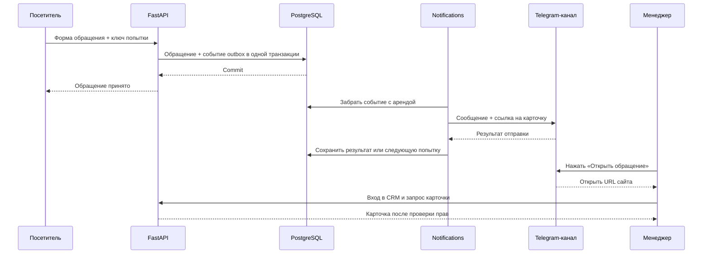

# Интеграция LAVR с Telegram

Проект от 20.10.2026. **Выбранный пользователем сценарий: уведомления сотрудникам о новых обращениях сайта со ссылкой в CRM.** Приём обращений от клиентов и управление статусами внутри Telegram в эту интеграцию не входят.

Реализованы сохранение обращения и outbox, процесс `notifications`, отправка URL-кнопки, защищённая карточка, повторы при сбоях, проверка подключения и общая пауза при `429`. Ниже — контур интеграции и порядок самостоятельного подключения. Реальный бот и канал подключаются отдельно; наличие кода не подтверждает доставку.

## Границы интеграции

Сотрудники получают уведомления в канале команды и переходят на сайт для обработки. Для запуска нужно настроить бота, канал и доступный адрес CRM, проверить подключение, отправить одно тестовое сообщение и отдельно включить обработку очереди.

Сайт и PostgreSQL остаются местом работы и хранения данных. Telegram показывает входящий поток; актуальные статусы, история и права сотрудников проверяются в CRM.

## Основной поток



1. Посетителю не требуется Telegram или вход на сайт. Проверяются контакты и текст; повтор одного ключа возвращает тот же результат без нового обращения.
2. После commit форма показывает «Спасибо, мы свяжемся с вами», без номера. Следующее обращение доступно сразу, с новым ключом; ошибки сохраняют незавершённую попытку.
3. Сбой Telegram не отменяет сохранённое обращение. Оно уже доступно в CRM, уведомление остаётся в очереди.
4. Каждое новое обращение создаёт отдельное сообщение. В канале получается последовательный список, текущий статус и история доступны в карточке.
5. Менеджер входит на сайт, берёт обращение в работу, связывается указанным способом, добавляет заметки и создаёт связанный заказ либо закрывает с причиной. Telegram не меняет этот процесс.

## Сообщение и доступ

Содержимое уведомления:

```text
Новое обращение № F-<дата>-<ID>
20.10.2026 18:30 МСК
Оставить запрос

[ Открыть обращение ]
```

Время приведено как пример. Внутренний номер сохраняется в CRM и уведомлении, хотя в публичной форме он больше не показывается. Телефон, email, контакт мессенджера и текст запроса остаются в CRM. Сообщение сообщает о факте создания; более поздняя обработка обращения не редактирует этот пост.

Кнопка — обычная ссылка:

```text
https://crm.example.ru/#crm-feedback?case=<UUID>
```

Её origin берётся из серверного `PUBLIC_SITE_URL`, не из заголовка входящего запроса. В ссылке нет пароля, cookie или токена. Без действующей сессии сайт показывает вход и после входа открывает выбранную карточку. Проверка manager/admin выполняется сервером. Участие в канале и знание UUID не предоставляют прав.

Для первого этапа использовать закрытый канал сотрудников и одного бота. Обычная URL-кнопка не требует Telegram Login, Mini App, webhook или привязки Telegram-профиля к сотруднику.

## Компоненты и данные

| Компонент | Ответственность | Состояние |
| --- | --- | --- |
| `backend/app/feedback.py` | Валидация, идемпотентность, запись обращения и события; защищённая работа менеджера | Реализован |
| PostgreSQL `feedback` | Обращение, контакты, ответственный, статус, связь с заказом | Реализован |
| PostgreSQL `outbox` | Задание `feedback_telegram`, попытки, аренда, следующая попытка, безопасный код ошибки | Реализован |
| `backend/app/notification_worker.py` | Получение задания, сборка сообщения, вызов Telegram, фиксация результата | Реализован, требует рабочих настроек |
| Vue CRM | Карточка по ссылке, вход, права и работа с обращением | Реализован |
| `backend/app/telegram_api.py`, `backend/app/telegram_cli.py` | Проверить бота, тип канала и право публикации; отдельно отправить технический тест | Серверные команды, очередь не запускают |
| Пауза направления при `429` | Сохранить время возобновления отправки для бота/канала, учитывать его для всех заданий | Хранится в PostgreSQL и переживает перезапуск |

Событие содержит ссылку на обращение, а не вторую копию контактов. Worker обслуживает только `feedback_telegram`; задания будущего обмена с 1С остаются отдельному процессу. Дополнительный брокер, микросервис и новая библиотека бота для исходящей отправки не нужны.

## Подключение своего тестового канала

Команды выполняются из каталога проекта на машине с Docker. Для теста используйте отдельного нового бота и свой канал. Настоящие токены в чат, исходники, команды терминала и адресную строку браузера не вставляйте: сохраните их через редактор только в серверном `.env.docker`.

### Подготовить бота и канал

1. В Telegram откройте официального [@BotFather](https://t.me/BotFather), отправьте `/newbot`, задайте имя и свободный username бота с окончанием `bot`. Сохраните выданный токен как пароль. [Инструкция Telegram](https://core.telegram.org/bots/tutorial#obtain-your-bot-token).
2. Используйте свой существующий закрытый канал. Для отдельного тестового окружения можно создать новый канал. [О каналах и их типах](https://telegram.org/faq_channels).
3. Откройте управление каналом → «Администраторы» → «Добавить администратора», найдите созданного бота по его username и разрешите публикацию сообщений. Нужное право Bot API называется `can_post_messages`; остальные расширенные права для отправки не нужны. [Права администратора](https://core.telegram.org/bots/api#chatmemberadministrator).

### Сохранить настройки с выключенной очередью

Если проект ещё не запускался, сначала выполните `./scripts/start.sh`: он создаст `.env.docker` с уникальными паролями. Существующий файл не заменяйте примером: в нём находятся секреты вашей базы и входа в CRM.

Перед вводом действующего токена остановите старый процесс отправки:

```sh
docker compose --env-file .env.docker stop notifications
```

Откройте `.env.docker` локальным редактором и задайте:

| Переменная | Значение |
| --- | --- |
| `TELEGRAM_NOTIFICATIONS_ENABLED` | `false` — очередь выключена до отдельного включения |
| `TELEGRAM_BOT_TOKEN` | Токен нового бота из BotFather |
| `TELEGRAM_CHAT_ID` | Для публичного канала — `@username`; для закрытого пока оставьте пустым |
| `PUBLIC_SITE_URL` | Для проверки канала можно оставить пустым: одно тестовое сообщение отправится без кнопки. Для рабочих уведомлений нужен доступный origin CRM, например `https://crm.example.ru`, без пути, query и fragment |

Эти параметры передаются только серверным процессам, не в `VITE_*`. `.env.docker` исключён из Git и Docker build context; секреты не входят в образ. Ограничьте доступ к файлу и обновите приложение:

```sh
chmod 600 .env.docker
./scripts/start.sh
```

Пока `TELEGRAM_NOTIFICATIONS_ENABLED=false`, worker не отправляет накопленные обращения. Перезапуск также применяет миграции БД, необходимые для общей паузы отправки.

Значение `PUBLIC_SITE_URL` само по себе не открывает сайт в интернете. Для проверки кнопки используйте доступный HTTPS-адрес, согласованный с прокси, `ALLOWED_ORIGINS` и защищёнными cookie по [README](../README.md#запуск-в-docker-и-перенос-на-другое-устройство). Пока такого адреса нет, оставьте значение пустым и проверьте отправку без кнопки. `127.0.0.1` на телефоне указывает на телефон; Telegram также может отклонять URL-кнопки на локальные адреса.

### Узнать ID закрытого канала

1. Сами опубликуйте в своём тестовом канале короткий технический текст. В меню этого сообщения выберите «Копировать ссылку»; при необходимости откройте канал в Telegram Desktop.
2. Для закрытого канала ссылка имеет вид `https://t.me/c/1234567890/7`. Число сразу после `/c/` — ID канала в формате MTProto; последнее число — ID сообщения, оно здесь не нужно. [Формат ссылок Telegram](https://core.telegram.org/api/links#message-links).
3. Прибавьте к ID канала `1000000000000` и поменяйте знак: `TELEGRAM_CHAT_ID = -(1000000000000 + ID_из_ссылки)`. Для примера выше получится `-1001234567890`. Сохраните свой результат в `.env.docker` через редактор. [Официальное преобразование ID для Bot API](https://core.telegram.org/api/bots/ids#supergroupchannel-ids).

Ссылка-приглашение `t.me/+...` для этого не подходит. Сторонние боты для пересылки сообщений, `getUpdates` и изменение webhook не нужны: назначение проверяется следующей командой.

У публичного канала можно сразу указать `@username`; следующая проверка покажет его числовой ID. Для постоянной настройки используйте этот ID, чтобы переименование канала не меняло адрес назначения. [getChat](https://core.telegram.org/bots/api#getchat).

### Проверить подключение и отправить одно сообщение

Проверка без публикации:

```sh
docker compose --env-file .env.docker run --rm --no-deps backend python -m app.telegram_cli check
```

`check` проверяет `getMe`, тип канала через `getChat` и право публикации через `getChatMember`. Если origin CRM заполнен, проверяется и его формат. Команда не создаёт обращения, не меняет очередь и ничего не отправляет. Успех подтверждает настройки и права, но не доступность CRM с телефона.

Явная отправка одного технического сообщения:

```sh
docker compose --env-file .env.docker run --rm --no-deps backend python -m app.telegram_cli test
```

`test` повторяет проверку, отправляет текст «Тест интеграции LAVR. Telegram-уведомления доступны. Это техническое сообщение, обращение не создаётся.» и показывает `message_id` при подтверждённом успехе. При заполненном `PUBLIC_SITE_URL` добавляется кнопка «Открыть CRM»; при пустом отправляется только текст и выводится пояснение, что ссылка не проверялась. В CRM не создаются обращения, накопленная очередь не запускается. Каждый успешный запуск `test` отправляет новое сообщение. После сетевого timeout или ошибки сервера сначала посмотрите канал: Telegram мог принять сообщение, даже если ответ потерян. Повтор может дать дубль.

Откройте кнопку на компьютере и телефоне: она ведёт в список обращений, при необходимости через вход manager/admin. Для остановки после одного технического теста оставьте `TELEGRAM_NOTIFICATIONS_ENABLED=false`.

### Отдельно включить уведомления об обращениях

Когда решите отправлять настоящие уведомления, задайте доступный `PUBLIC_SITE_URL` и проверьте кнопку. Затем учтите накопленную очередь: после включения worker отправит **все ожидающие события**, включая ранее созданные обращения. Пропуск старых уведомлений отдельной операцией пока не реализован; удалять обращения ради очистки очереди нельзя.

Поставьте в `.env.docker` `TELEGRAM_NOTIFICATIONS_ENABLED=true` и примените настройки:

```sh
./scripts/start.sh
docker compose --env-file .env.docker logs -f notifications
```

После включения на тестовом окружении отправьте форму с вымышленными контактами и проверьте уведомление: номер, московское время, тип формы и кнопка на точную карточку после входа. Повторите для второго варианта формы. Сообщение worker в журнале о наличии настроек само по себе не доказывает доставку.

Для паузы установите `false` и снова выполните `./scripts/start.sh`; немедленно остановить процесс можно командой `docker compose --env-file .env.docker stop notifications`. Уже начатая сетевая отправка может завершиться. При смене токена или канала сначала остановите worker и повторите `check` и `test` с выключенной очередью. Ожидающие и неопределённые попытки используют новый канал; завершённые автоматически не пересылаются. Отдельная версия назначения в событии не фиксируется.

## Локальная проверка

На локальном сайте [http://127.0.0.1:8080](http://127.0.0.1:8080) можно проверить приём и работу с обращением без Telegram. Для исходящих уведомлений серверу нужен доступ к Telegram по HTTPS; входящий webhook основному сценарию не нужен.

Для проверки кнопки с телефона нужен доступный с телефона HTTPS-адрес сайта, например отдельное тестовое размещение. `127.0.0.1` на телефоне указывает на сам телефон. Открытие сайта в Telegram не обходит вход сотрудника. Публикация локальной машины или создание внешнего туннеля не входят автоматически в подключение бота.

## Доставка и ошибки

Outbox записывается вместе с обращением. Worker занимает задание на 60 секунд, выполняет сетевой вызов вне транзакции БД с HTTP timeout 10 секунд и сохраняет результат только если попытка всё ещё принадлежит ему. Перезапуск не теряет задание; запоздавший ответ не перезаписывает новую попытку.

| Результат | Поведение |
| --- | --- |
| Подтверждённый успех | Событие `done`; это принятие сообщения Telegram, не прочтение менеджером |
| Временный сбой | Повторы через 5 секунд, 30 секунд, 2 минуты, затем 15 минут |
| `429` | `retry_after` откладывает событие и всю отправку тому же боту/каналу; общая пауза хранится в БД |
| Ошибка токена/прав/адресата | Безопасный код ошибки, перепроверка не чаще раза в 15 минут после исправления |
| Сетевой timeout или неоднозначный ответ | Состояние `uncertain`; повтор может создать второе сообщение с тем же номером, но не второе обращение |
| Настройки отсутствуют или `TELEGRAM_NOTIFICATIONS_ENABLED=false` | Обращения принимаются; события остаются ждать включения |

Один исходящий worker делает паузу между отправками. Это соответствует рекомендованному Telegram ограничению частоты для одного чата; `429` требует ожидания. [Официальные ограничения](https://core.telegram.org/bots/faq#my-bot-is-hitting-limits-how-do-i-avoid-this), [retry_after](https://core.telegram.org/bots/api#responseparameters).

Для первого запуска оставьте одну реплику worker. Общая пауза направления хранит время возобновления в PostgreSQL для пары бот/канал. Пока оно не наступило, worker откладывает новые отправки, а технический `test` сообщает необходимость подождать без автоматического повтора. Пауза переживает перезапуск; смена назначения не снимает паузу со старого направления.

Перед увеличением числа реплик также потребуется общее ограничение частоты: нынешние аренды защищают от захвата одного события, но не ограничивают суммарную отправку разных событий.

Гарантируется сохранность обращения независимо от Telegram; отсутствие дублей сообщений после потерянного ответа не обещается. Успех Bot API проверяется по ответу и `message_id`, но текущий код этот идентификатор не сохраняет. Если понадобятся ссылки на публикацию или обновление сообщений при смене статуса, потребуется хранить `chat_id/message_id` и отдельные события обновления; для первого этапа это не требуется.

В CRM уже видны ожидающее уведомление, отправка, ошибка, неопределённый исход или отсутствие настроек. Расследование начинается с карточки и безопасного кода в журнале. Контакты, текст обращения и URL Bot API с токеном не журналируются.

## За рамками выбранного сценария

Приём клиентских сообщений, вложения, переписка, Telegram Login и команды управления в боте не требуются. Обращения поступают через форму сайта; менеджер выполняет все действия в CRM. Входящий webhook и таблицы диалогов не добавляются. Уведомления о заказах из 1С потребуют отдельного решения о событиях и содержимом сообщений.

## Приёмка и дальнейшие действия

1. **Подключение:** корректные бот/канал/право публикации/адрес CRM; неверный токен и отсутствие прав дают понятную диагностику без утечки секрета.
2. **Поток:** новая форма создаёт одно обращение и событие; уведомление содержит только номер, время, вариант и кнопку. Контактов и текста в канале нет.
3. **Доступ:** ссылка открывает точную карточку после входа, не даёт доступ гостю и не загружает чужие приватные данные без прав. Проверяются телефон и компьютер.
4. **Сбои:** отключённый Telegram, `429`, потерянный ответ и перезапуск не теряют обращение; неизвестный исход честно отображается, повтор не создаёт новую заявку. Общая пауза `retry_after` применяется ко всей очереди направления и сохраняется после перезапуска.
5. **Эксплуатация:** согласованы накопленная очередь и смена назначения; worker не забирает события 1С. Старые внутренние номера в CRM сохраняются.

Автоматические проверки обращения, формирования уведомления, очереди, аренды, ошибок, предварительной проверки и ссылок находятся в `backend/tests/test_feedback.py`, `backend/tests/test_notification_worker.py`, `backend/tests/test_telegram_api.py` и `tests/browser-feedback.mjs`. Они используют подменённые ответы Telegram и не доказывают наличие рабочего токена, прав канала, сетевого доступа или доставку реальному Telegram.

Для реальной проверки владелец создаёт бота и канал, заполняет свои серверные настройки, запускает `check`, затем явно запускает один `test`. Работа с настоящим токеном и отправка в канал во время разработки не выполняются.
